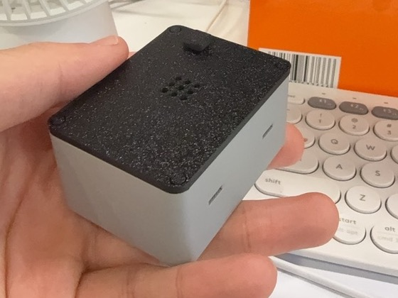
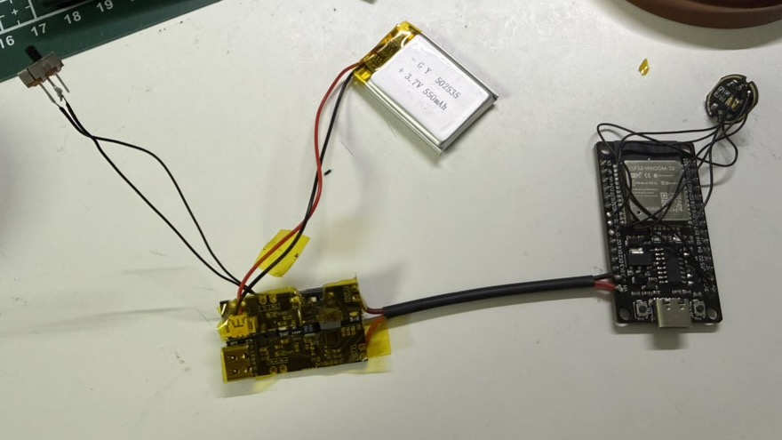

# VOXU

基于 **ESP32 + INMP441** 的无线语音输入硬件原型：通过 Bluetooth Classic HFP 向 Mac 传送麦克风音频，并通过蓝牙 HID 将 BOOT 按键映射为 `F13`，在 Typeless 中按一下开始听写、再按一下结束。

仓库包含固件、接线说明、物料清单、参数化 3D 打印外壳及验证记录。当前蓝牙设备名仍为 **`Voice Puck V1`**；电池版产品方案称为 **VOXU V2**，外壳修订号与产品版本号分别记录。

## 实拍图



*原型外壳实物，手持展示整机大小与外观。*



*电池版原型接线，展示各模块及连接关系。实拍仅记录装配状态，电气验证进度见下文。*

## 外壳预览


*上图为 CAD 预览，电池版仍在机械试装与电气验证阶段。*

## 功能与进度

| 项目 | 当前状态 |
| --- | --- |
| I²S 麦克风采音 | 已有 ESP32-WROOM-32 + INMP441 实机采样记录 |
| Mac 蓝牙音频输入 | 已验证 HFP / mSBC 16 kHz 链路，保留测试音与测量记录 |
| BOOT → F13 → Typeless | 已实物确认快捷键录入、开始/结束听写及出字 |
| 开机自动连接 | 保存最近成功连接的电脑，主动连接 HFP/HID；已有三轮重启验证 |
| 无音频通道时暂停采集 | 已实现 SCO 断开后停止 I²S 时钟；尚未刷机验证节电效果 |
| USB 供电外壳 | V4 紧凑卡扣结构；部分装配已验证，新卡扣手感与耐用性待验证 |
| V2 电池外壳 | 第 7 版 UPS 槽位修正，已有 CAD 检查与切片记录；整机电气、续航与强度待验收 |

以上是仓库已有记录，不代表每次固件更新后都完成了整机复测。详细证据见 [HFP 固件说明](firmware/hfp-probe/README.md)、[F13 验收](firmware/hfp-probe/evidence/boot-f13-validation.md)和[自动连接验收](firmware/hfp-probe/evidence/auto-connect-validation.md)。

## 工作方式

```text
INMP441 ── I²S ──> ESP32 ── Bluetooth Classic HFP ──> Mac 音频输入
BOOT 按键 ────────> ESP32 ── Bluetooth Classic HID ──> F13 / Typeless
```

固件只发送快捷键，听写状态由 Typeless 管理。按键松开不会再发送一次 F13，长按不重复触发。麦克风是否采集取决于 SCO 音频通道状态，不取决于本机记录的按钮状态。

## 快速开始：USB 供电原型

建议先验证 USB 供电下的采音与蓝牙链路，再进行电池版装配。

### 1. 准备硬件与工具

- 原版 ESP32 开发板。当前验证对象为 30 针 ESP32-WROOM-32、芯片 `ESP32-D0WD-V3`；本固件依赖 Bluetooth Classic HFP/HID，其他 ESP32 系列板不能直接视为兼容。
- INMP441 I²S 麦克风、连接线及可传输数据的 USB 线。
- Mac；使用按键听写功能时需配置 Typeless。
- 已安装 `uv`，下方通过 `uvx` 运行 PlatformIO。工程使用 ESP-IDF，PlatformIO 环境为 `esp32dev`。

先断电，按模块和开发板丝印接线：

| INMP441 | ESP32 |
| --- | --- |
| VDD / VCC | **3V3，不可接 VIN / 5V** |
| GND | GND |
| SCK / BCLK | D26 / GPIO26 |
| WS / LRCLK | D25 / GPIO25 |
| SD / DOUT | D33 / GPIO33 |
| L/R / SEL | GND（左声道） |

首次上电与排查步骤见 [WIRING.md](WIRING.md)。

### 2. 验证麦克风采样

```sh
git clone https://github.com/krisxia0506/voxu.git
cd voxu/firmware/i2s-smoke
uvx --from platformio platformio run
uvx --from platformio platformio device list
```

从设备列表找到开发板串口，将下面的 `/dev/cu.usbserial-110` 替换为实际端口：

```sh
uvx --from platformio platformio run -t upload --upload-port /dev/cu.usbserial-110
uvx --from platformio platformio device monitor --port /dev/cu.usbserial-110 --baud 115200
```

对着麦克风说话，观察 `mean_abs` 与 `peak` 是否随声音变化。持续为零或异常固定值时先检查接线。按 `Ctrl+C` 退出监视器，详见 [I²S 冒烟测试](firmware/i2s-smoke/README.md)。

### 3. 刷入蓝牙固件

从上一步的 `firmware/i2s-smoke` 目录执行：

```sh
cd ../hfp-probe
uvx --from platformio platformio run
uvx --from platformio platformio run -t upload --upload-port /dev/cu.usbserial-110
uvx --from platformio platformio device monitor --port /dev/cu.usbserial-110 --baud 115200
```

同样替换串口名称。在 Mac 上配对 **`Voice Puck V1`**，在“系统设置 → 声效 → 输入”中选中它。音频通道接通时可观察到 `HFP=1, SCO=1, codec=mSBC`。

Mac 会同时列出该设备的输入和输出端点，但硬件没有扬声器。**输出仍请选择 Mac 扬声器或其他实际使用的音箱。**

### 4. 配置 Typeless 按键

1. 在 Typeless 的语音输入快捷键设置中添加一个绑定，正常启动后按一次 BOOT，确认录入 `F13`。
2. 麦克风选择 `Voice Puck V1`，或确认自动检测使用该输入。
3. 按 BOOT 开始听写，说话后再按一次，确认停止并输出文字。

不要在上电或复位时按住 BOOT，否则会进入下载模式；EN 是复位键。旧配对未枚举 HID 时，可能需要移除设备后重新配对。完整行为与断线边界见 [HFP / HID 固件说明](firmware/hfp-probe/README.md)。

## 外壳与电池版

| 方案 | 外壳尺寸 | 文档与下载 |
| --- | --- | --- |
| USB 供电 V4 | 60 × 40 × 19.4 mm，含按钮约 22 mm 高 | [打印装配说明](hardware/enclosure/README.md) · [STL ZIP](hardware/enclosure/voxu-p2s-prototype.zip) |
| V2 电池版，第 7 版外壳 | 62 × 46 × 31.4 mm，含按钮 34 mm 高 | [打印装配说明](hardware/enclosure-battery/README.md) · [STL ZIP](hardware/enclosure-battery/voxu-battery-fit-prototype.zip) · [物料清单](hardware/enclosure-battery/V2-BOM.md) |

V2 使用现有 ESP32、INMP441、常规款 5V UPS 充电升压一体板、3.7V / 550mAh 电池和 SS12D00G3 控制开关。当前方案由 **UPS USB-C 充电，隐藏的 ESP32 USB-C 单独刷机**，不是一个接口同时充电和刷机。

电池允许充放电规格、UPS 充电参数匹配、反向隔离、温升和续航仍未完成确认。电池版刷机前须按[电源接线说明](hardware/enclosure-battery/wiring.md)物理断开 J1 的整对 UPS 输出线，不能只关闭开关。制作或通电前请完整阅读该说明。

STL 需要在自己的 Bambu Studio 配置中重新切片，下载包不提供 G-code。CAD、切片检查不替代实际装配与电气验收。

### 查看交互装配预览

在仓库根目录启动本地静态服务：

```sh
python3 -m http.server 8000 --bind 127.0.0.1
```

然后打开 [电池版装配与接线预览](http://127.0.0.1:8000/hardware/enclosure-battery/preview.html)。可查看分层结构、元件位置、螺丝孔位和接线演示；结束后按 `Ctrl+C` 停止服务。GitHub 文件页面本身不运行该 HTML。

## 仓库导航

| 路径 | 内容 |
| --- | --- |
| [firmware/i2s-smoke/](firmware/i2s-smoke/) | 无蓝牙的麦克风采样测试 |
| [firmware/hfp-probe/](firmware/hfp-probe/) | HFP 音频、F13 按键、自动重连、主机回归测试与实测证据 |
| [hardware/enclosure/](hardware/enclosure/) | USB 供电外壳参数、生成脚本、模型与验证记录 |
| [hardware/enclosure-battery/](hardware/enclosure-battery/) | 当前电池外壳、BOM、接线规划、交互预览及切片脚本 |
| [WIRING.md](WIRING.md) | 麦克风接线与首次上电说明 |
| [BOM.md](BOM.md) / [V1-DESIGN.md](V1-DESIGN.md) | 早期采购记录与 USB 供电版设计；电池版以当前目录说明为准 |
| [docs/superpowers/](docs/superpowers/) | 设计过程、测量与研究记录，包含已被替代的方案 |

## 开发与验证

固件编译命令见上文；不连接硬件也可在仓库根目录运行按键和重连状态机测试，需要本机 C 编译器：

```sh
cc -std=c11 -Wall -Wextra -Werror -Ifirmware/hfp-probe/src \
  firmware/hfp-probe/tests/boot_button_test.c firmware/hfp-probe/src/boot_button.c \
  -o /tmp/voxu-boot-test && /tmp/voxu-boot-test

cc -std=c11 -Wall -Wextra -Werror -Ifirmware/hfp-probe/src \
  firmware/hfp-probe/tests/hfp_reconnect_test.c firmware/hfp-probe/src/hfp_reconnect.c \
  -o /tmp/voxu-reconnect-test && /tmp/voxu-reconnect-test
```

外壳修改从各目录的 `parameters.json` 入手，依照对应 README 安装 Python 依赖并运行 `generate.py`；电池版另提供 `slice.py`。生成后的几何检查与切片结果分别记录在 `validation.json` 和 `slicer-result.json`。

当前仍需验证长期连接稳定性、Mac 休眠/合盖恢复、其他电脑兼容性和语音音质。HID 报告提交瞬间断线可能在重连后额外发送一次 F13；主机状态机测试不能覆盖整个蓝牙栈行为。当前固件也不提供电池管理或硬件静音，暂停 I²S 不等于整机深度睡眠。

## 许可证

代码采用 [MIT](LICENSES/MIT.txt)，项目原创文档、CAD、图片与测量记录采用 [CC BY 4.0](LICENSES/CC-BY-4.0.txt)。文件分类、混合 HTML 页面、ZIP 分发与第三方材料的范围见 [许可说明](LICENSE.md)。

提交代码或验证资料前，请使用 GitHub noreply 提交邮箱；不要加入真实设备地址、凭据或包含私人背景声音的录音。实录音频不随仓库分发，保留合成测试音与文字测量记录。
