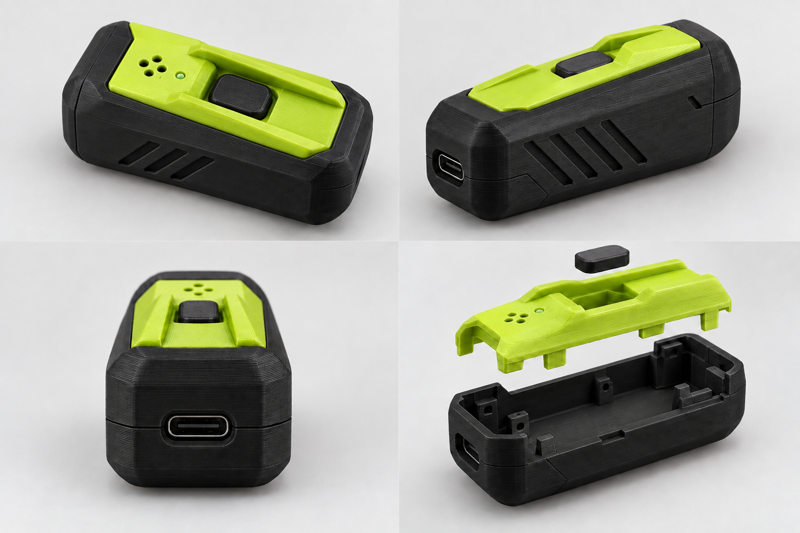

# Voice Puck V1 外观与试装结构

2026-09-29 选定 **M：双层护脊壳** 为外观方向；同日按用户确认的开发板 51.45 × 28.33 mm、圆形 INMP441 14 mm 生成第一版机械试装模型。

当前制造目标为 **拓竹 P2S**。仅容纳开发板、麦克风和连接线，使用板载 USB 接口有线供电，无电池仓、无电源开关。外部按帽通过机械顶杆按下现有 BOOT，保留开始/结束操作。

[下载与打印装配说明](hardware/enclosure/README.md) · [STL 打包文件](hardware/enclosure/voxu-p2s-prototype.zip) · [参数](hardware/enclosure/parameters.json)

试装版外廓 88 × 42 × 29.4 mm，保留深色底座、亮色上盖和双护脊。为直接触动板载 BOOT，按钮位于 USB 一端；为便于拆装，采用四枚可见的 M2 自攻螺钉。暂不实现概念图的隐藏卡扣、装饰状态灯或固定 USB-C 接口造型。

**制造状态：可打印试装模型，未实物验收。** 板体平面尺寸已由用户确认；PCB 厚度、BOOT 中心位置/高度/行程、接口高度、排针和接线空间仍采用明确标注的试装假设。提供三种顶杆长度及板体/导向试装件，完成打印、USB 插接、按键回弹和录音验证后再定版。
