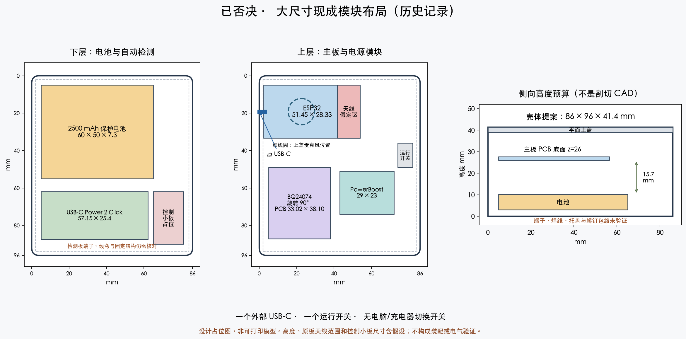

# 现成模块电池版：分层布局与控制提案

状态：供设计审阅的提案，尚无 STL；不是装配验收通过的成品。对应主规格与单口、无切换、MacBook USB-C 的已确认目标。

## 外形与摆放

外廓预算 **86 × 96 × 41.4 mm**，交流时约称 86 × 96 × 42 mm。按钮凸出量另计。侧面保留开发板原 USB-C 和运行开关，顶部为平面上盖、BOOT 按钮、麦克风声孔；不设置第二充电口或模式开关。

坐标单位均为 mm。X=0 为原 USB 插入侧；Y 为沿侧面的另一方向；Z=0 为底面。

| 部件 | X / Y | XY 占位 | Z 预算与依据 |
| --- | --- | --- | --- |
| 2500mAh 保护电池 | 5 / 5 | 60 × 50 | 底面 3，名义顶面 10.3；只包含电池额定外廓，保护端/导线仍需核对 |
| MIKROE USB-C Power 2 Click | 5 / 62 | 57.15 × 25.4 | PCB 底面暂取 4；元件及连接器完整高度尚未确定 |
| 检测供电/逻辑控制小板 | 65 / 62 | 16 × 28 | PCB 底面暂取 4；尚未排板，是占位而非已验证尺寸 |
| ESP32 PCB | 2.4 / 5 | 51.45 × 28.33 | 底面 26；PCB 厚度 1.6；沿用旧版 USB 与 BOOT 相对位置 |
| BQ24074 PCB，旋转 90° | 5 / 49 | 33.02 × 38.10 | 底面暂取 25；自带插座及接线弯折需纳入后续包络 |
| PowerBoost Basic | 43 / 51 | 29 × 23 | 底面暂取 26；不安装随附大连接器 |
| 运行开关 | 74 / 36 | 8 × 13 | 占位，不是开孔尺寸；最终按实际外廓/行程画支架 |
| 上盖 | 0 / 0 | 86 × 96 | 下表面 39、厚度 2.4 |

电池名义顶面至主板底面为 **15.7 mm**。这是一个高度预算，不能替代天线净空验证：电池制造公差、固定带、保护小板、麦克风铜箔、导线和螺钉都要加入实体检查。图中把主板末端 12 mm 标成假定天线区，真实边界需依据实物和模组图纸更新。

麦克风中心先移到 X=22.5、Y=19.165，沿用已验证的 14 mm 卡槽几何；BOOT 的相对主板位置不变。移动用于增大与天线的间距，但麦克风压框、导向柱、焊线及可选紧固件仍需三维检查。天线附近的可选紧固应优先使用绝缘件。

这张图仅证明 PCB/电池名义 XY 矩形可以分层摆下，不证明壳内能装下全部连接器、线束、托盘和卡扣。不得据此直接订做精确尺寸外壳或发出打印包。

## 独立于主控的自动检测控制

本轮已查看 MIKROE 原理图 v101 的图形原件，确认：

- PTN5150A 的 CC1/CC2 接模块 Type-C 插座，原理图未提供可直接代替原板接口的独立 CC 排针；接入原开发板接口仍涉及 CC 节点细线焊接。
- J1 引出 O1/O2/O3；JP4/JP5/JP6 选择 OUT 或 I²C 通信。JP7 为 PORT 模式选择；JP8 配合连接检测信号路径。不能仅改一个跳线就宣称配置完成。
- 控制部分用外部 3.3 V。NX5P3090 的受电路径输出为 VSNK；另一路 VSRC 是供电路径，本项目不使用它，也不向 mikroBUS 5V 供电。
- 输入检测、受电开关与 BQ 控制必须在 ESP32 未运行时工作。不能取用原板随运行开关关闭的 3V3 作为检测板唯一电源。

以下是拟议逻辑，仍待完整接线图和启动/掉电验证：

1. RAW_USB_5V 经独立 3.3 V 稳压器供检测板和逻辑电路；不由电池提供这路电源。
2. PTN5150A 固定 UFP、非 I²C 模式。原板 CC 的 Rd 按最终追线结果处理，避免与芯片内部 Rd 并联。
3. 受电路径 VSNK 接 BQ VBUS；BQ EN2 由这路独立 3.3 V 控制。使用连接检测和 OUT1 决定 EN1，而不是只看 OUT1 的一个静态值。
4. 定义 `GRANT = CON_DET AND NOT OUT1`，`EN1 = NOT GRANT`。在连接有效且声明为 1.5 A/3 A 时，BQ 为 EN1=0、EN2=1 的外部限流档；其他有 USB 电压的状态为 standby。该逻辑可用两级 NAND 实现，器件、电平和上电默认态仍须完整核对。
5. 若继续用 BQ 外部限流档，将主版本原理图中的 **R1（默认 1 kΩ、0603）改为 1.8 kΩ、1%**；计算输入范围约 0.825–0.965 A，典型约 0.894 A。电池充电跳线选厂家标记的 0.5 A 档。此参数只适用于已获得 1.5 A/3 A 授权的分支，不能用于替代默认 USB 电流处理。

| 状态 | 预期输入行为 | 系统行为 / 尚需验证 |
| --- | --- | --- |
| MacBook 声明 1.5 A 或 3 A | 自动使能充电电源路径；总输入受限 | 原 CH340 负责刷机，同时可充电；需实测净充电电流 |
| USB-C 充电器声明 1.5 A 或 3 A | 同上，不需模式切换 | 支持关机充电；开机负载与充电共享输入预算 |
| 电池耗尽后插入上述电源 | CC 内部无电池 Rd 使源端提供 VBUS，独立控制电源随后启动 | 不依赖 ESP32 先运行；实际恢复过程需验证 |
| 拔线 | 输入路径退出，系统由电池保持 | 要验证拔插瞬态和蓝牙采音不复位 |
| 默认 USB 电流声明、USB-A 转接、电脑休眠后供电改变 | 本控制提案尚不包含充电许可的完整处理 | **这是未完成项，不是已经满足“所有接法自动充电”**；不得隐藏成不充电的产品行为 |

## 控制元件与限流计算

针对上述 CC 分支，控制小板可用 **MCP1700-3302E/TO 独立 3.3 V 稳压器**和 **SN74HC00N 四路 NAND**作为设计候选。前者从 RAW_USB_5V 取电，后者用两级门实现 `EN1 = NOT(CON_DET AND NOT OUT1)`；余下门的输入不能悬空。控制小板还需稳压输入/输出电容、逻辑去耦和明确的上拉/下拉。完整引脚图、元件布置及启动状态未完成，不能仅凭这两个料号开始接线。

[Microchip MCP1700](https://www.microchip.com/en-us/product/MCP1700)输入上限为 6 V，仅用于本提案不请求高压的 5 V USB 路径；[TI SN74HC00](https://www.ti.com/product/SN74HC00)工作电源范围为 2–6 V，可使用独立 3.3 V 供电。控制信号不得上拉到 BQ OUT（可能为 4.4 V）；掉电时也不能由电池侧经控制引脚反向给检测板供电。

核对 [Adafruit 主版本原理图](https://github.com/adafruit/Adafruit-BQ24074-PCB/blob/master/Adafruit_BQ24074.sch)，此次读取的 Git blob 为 `a97e12c1628a74e95eb0af333206ff6f3706126c`：R1 接 ILIM，SJ2 中间节点为 EN1，SJ1 中间节点为 EN2；两个跳线的 1 号焊盘接 OUT。因此必须断开旧跳线后再接独立控制电源，不能把 3.3 V 与 OUT 短接。实物版本可能不同，焊接前仍需核对丝印及导通。

[TI BQ2407x 数据手册](https://www.ti.com/lit/ds/symlink/bq24074.pdf)在 0.5–1.5 A 档的输入电流系数范围为 1500–1720 AΩ，典型 1610 AΩ。对 1.8 kΩ、1% 电阻：

- 最小限流约 `1500 / (1800 × 1.01) = 0.825 A`。
- 典型约 `1610 / 1800 = 0.894 A`。
- 最大限流约 `1720 / (1800 × 0.99) = 0.965 A`。

限流约束的是 BQ 输入支路，独立检测电路及任何直接接 RAW_USB 的 UART 消耗另计。即使采用该值，也需测总 USB 输入，不能把 0.965 A 误当成整机测量结果。

### 散热预算

以输入 5.25 V、电池 3.0 V、充电 0.5 A、OUT 为 4.4 V、升压效率 85% 作为一个估算工况：

`充电器损耗 ≈ (5.25−3.0)×0.5 + (5.25−4.4)×(5.2×系统电流/(0.85×4.4))`

当系统 5.2 V 电流为 0.20/0.25/0.30 A 时，得到约 **1.36/1.42/1.48 W**。这是线性充电器的工况预算，不是全条件最坏值，也不是实测；最大电流、输入压降、热限流都会改变结果。

因此充电板上方需留空气空间，与软包隔开；不得用泡棉整面包住充电板，也不能提前承诺密闭壳内始终维持标称充电电流。实测热限流后仍须满足目标使用状态下电池净充电。

## 为什么还不冻结模块与外壳

现成 CC 模块增加了面积和改焊步骤，但免去了直接焊接 1.6 mm QFN 控制芯片。若用户不接受这一体积，需要评估紧凑控制 PCB 和代焊，而不是继续在图上压缩电池间隙。

进入最终 CAD 前还需：完成默认电流声明分支、确认控制电平与启动状态、核实连接器完整包络及逻辑板尺寸。实物供电网/焊点、净充电、续航和打印装配验证继续保持独立验收项。

## 资料与重现

- [MIKROE 原理图 v101](https://download.mikroe.com/documents/add-on-boards/click/usb-c-power-2-click/usb-c-power-2-click-schematic.pdf)
- [PTN5150A 数据手册](https://download.mikroe.com/documents/datasheets/PTN5150A_datasheet.pdf)，第 6.2、7.1、7.4、7.5 节：引脚、无电池 Rd、掉电回灌和 GPIO 模式。
- [自动充电模块调查](2026-09-30-usbc-power-options.md)
- [可缩放布局图](2026-09-30-battery-layout-proposal.svg)

布局渲染脚本为 `draw_battery_layout.py`，使用现有 CAD Python 环境的 matplotlib；运行后在同目录生成 PNG/SVG。脚本不生成外壳实体，也不执行碰撞验证。
