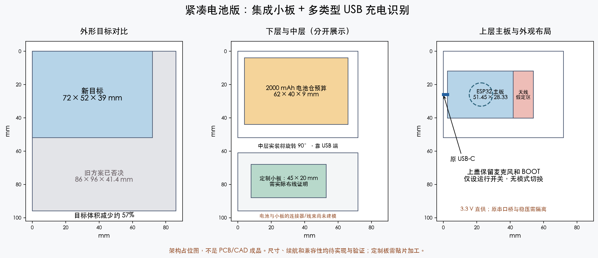

# VOXU 紧凑单 USB-C 电池版设计

日期：2026-09-30。基线：main `81804c4`，PR #3 和 #4 已合入。

**状态：根据用户否决大尺寸方案后的架构修订。尚未完成电路图、PCB 布线、CAD/STL、打板或实测。本文不是直接采购/焊接说明。**

## 1. 已确认的要求

- 复用现有 ESP32-WROOM-32、30 针开发板、原 USB-C 接口与 14 mm 圆形 INMP441。
- 保持现有麦克风、BOOT 操作及蓝牙自动重连功能，目标持续连接并采音 4–6 小时。
- 同一个 USB-C：接电脑充电并刷机，接充电器充电，拔线自动用电池；不设电脑/充电器切换开关。
- 主要电脑是 MacBook USB-C；**充电器应尽可能兼容多种类型，不能限定只有 USB-C 和 C-to-C 线。**
- **86 × 96 × 42 mm 模块堆叠方案已被否决。** 不再使用大型 Click 检测板、Adafruit 充电板、PowerBoost 板叠加作为成品方案。
- 交付 BOM、电路/接线/改造与装配说明、可编辑外壳源码、STL、实际预览、打印包和分项验证记录；原 USB 版保持独立。

## 2. 收敛后的架构

采用一块定制电源/USB 小板，整合 USB 电源识别、串口桥、负载分配充电、3.3 V 升降压和掉电信号隔离。保留 ESP32 主控板，但隔离其原 CH340 与 5 V→3.3 V 稳压通路，避免两套电路并联。小板需要打板和贴片加工；不能当成现成模块接几根电源线即可完成。

改为直接产生稳压 **3.3 V** 给主控和麦克风，取消“电池升到约 5.2 V，再由原板线性降到 3.3 V”的路径。较低的系统功率预算有助于采用更窄电池并降低普通电脑口的充电负担。实际收益必须测量。

```text
原 USB-C
 ├─ CC1/CC2 ── PTN5150A（受电端）──── 电流声明/连接状态 ─┐
 ├─ D+/D− ──── FT231X（替代原 CH340）── 枚举/充电器检测 ─┤
 │                  └─ TX/RX/DTR/RTS ─ TXU0304 ─ 原下载电路/ESP32
 └─ VBUS ── USB 控制电源（插线即工作）                   │
         └─ BQ24074 ← 硬件许可与限流控制 ←───────────────┘
              ↕         │ OUT
          保护电池      TPS63802 → SYS_3V3 → ESP32 / INMP441
                         ↑ EN
                       运行开关
```

USB 检测、FT231X 和充电控制从外部 VBUS 取得电源，不依赖电池或 ESP32 启动。这是空电池接电脑恢复和关机充电的基础。运行开关关闭系统稳压输出，不关闭充电控制。

## 3. 核心器件候选与用途

| 器件 | 用途 | 选型依据 / 尚需完成 |
| --- | --- | --- |
| PTN5150A | USB-C CC 电流与连接检测，固定 UFP | 支持断电时内部 Rd；直接使用 IC，取消 57 mm Click 模块；核对封装、供应与 GPIO 时序 |
| FT231XQ | USB UART、专用充电器检测、枚举/挂起输出 | 替代原 CH340；MTP 需配置 500 mA 请求、CBUS 和充电检测，作为小板生产配置步骤 |
| BQ24074 | 单节 4.2 V 锂电充电及负载分配 | 对系统负载和电池充电分别管理；需要 NTC 和输入许可，不单凭 VBUS 有电就大电流充电 |
| TPS63802 | 3.3 V 升降压、关断时负载断开 | 厂家给出 3.3 V、输入≥2.3 V 时 2 A 能力；电感、电容、反馈和瞬态必须按实际 PCB 设计验证 |
| TXU0304 | USB 域与 SYS_3V3 域之间的四路信号隔离 | 3 路桥→主控、1 路主控→桥，覆盖 TX、DTR、RTS、RX；处理关机或拔 USB 时的 IO 灌电 |
| 逻辑门、限流选择 MOSFET | 硬件许可与限流选择 | 控制电源优先使用 FT231X 的 3V3OUT，外部负载预算≤10 mA；该输出额定 50 mA，不能用于给 ESP32 供电；具体封装、默认态和去耦落入原理图 |
| 单节保护电池，约 2000 mAh | 缩小宽度，保留续航目标 | 以 Adafruit #2011 的 60 × 36 × 7 mm 为尺寸参考；其关联文件存在 LP803860 型号，先留 62 × 40 × 9 mm 电池仓包络，供应/实物尺寸需确认 |
| 10 kΩ NTC、运行开关、连接器/绝缘件 | 温度监测、用户开关与装配 | NTC 参数匹配充电器；电池保护和 NTC 均不能省略 |

以上是架构级候选，不是完整制造 BOM。尤其不能将未核对的电池型号替换后继续沿用旧外壳。电池参考页本轮显示缺货，采购版本与可用替代件尚未锁定。

## 4. USB 自动识别与充电策略

兼容性用明确的电源类别和验证矩阵定义，不使用“所有充电器保证可用”的表述。

| 接入类型 | 识别依据 | 设计行为 |
| --- | --- | --- |
| MacBook / USB-C 主机，声明 1.5 A 或 3 A | CC 连接有效及电流声明 | 自动充电，FT231X 同时承担刷机数据；不请求 9/12/20 V |
| 普通 USB 数据主机 / USB-A 转 C 数据线 | FT231X 成功配置及功耗请求 | 枚举成功后进入较低输入限流档，允许同时刷机和充电 |
| USB-A BC1.2 DCP 充电器 | FT231X 专用充电器检测 | 自动进入充电档，无需主机枚举 |
| CDP 充电数据口 | 先按已枚举的 USB 数据口处理 | 保守限流并保留数据，不为了宣称更快充电而假定 1.5 A 授权 |
| USB-C 充电器，声明 1.5 A 或 3 A | CC 检测 | 自动充电；覆盖常用 USB-C/PD 充电器的 5 V 供电，不请求高压 |
| 主机挂起/断开授权 | CC 与 FT231X 状态变化 | 自动降低/关闭外部输入，必要时电池维持运行；恢复后重新判断，不需切档 |
| 不规范充电器、仅私有分压识别、数据脚悬空或异常线缆 | 尚无可靠许可 | 不冒充已兼容；保留测试项。优先覆盖上面的标准类别，异常类别不得默认放大电流 |

定义 `C = CC连接有效且声明≥1.5A`、`D = FT231X确认DCP`、`E = FT231X成功配置且未挂起`。

- 允许充电输入：`G = C OR D OR E`。
- 高输入预算：`H = C OR D`；其余已配置数据主机采用低输入预算。
- 无许可时 BQ 使用 standby；系统可以继续用电池，不能把电池放电误报为正在充电。
- 以上是稳态逻辑。复位、插拔、挂起、无电池启动、各信号失效/高阻、输出下拉都必须在原理图和实物中验证。

FT231X 的枚举和 DCP 检测走同一个 USB PHY，避免把独立检测芯片未经时序管理直接并联到 CH340 数据线上。USB 控制域和主控域之间通过 TXU0304；不能把 DTR/RTS 直接改接到 EN/BOOT 而跳过原来的自动下载逻辑。

## 5. 输入电流预算

当前主机上已读取到一个 WCH `1a86:7523` 设备，`bMaxPower=49` 即 98 mA；它与照片板的对应关系未独立确认。该证据不支持假定旧串口桥已申请 500 mA。[只读记录](../research/2026-09-30-usb-readonly-evidence.json)保留原始结果及限制。

定制板拟采用两档 ILIM 电阻网络：基础 **4.53 kΩ、1%**；高预算时并联 **3.01 kΩ、1%**，等效约 1.81 kΩ。MOSFET 的导通电阻和漏电也需纳入最终误差。

按 BQ24074 数据手册相应档位系数计算：

| 档位 | 预计输入限流范围 | 约束 |
| --- | --- | --- |
| 已配置普通数据主机 | 约 0.291–0.384 A | 控制域额外电流另计；控制域预算上限 50 mA，则合计上限约 434 mA，低于拟请求的 500 mA |
| 已识别 DCP / CC 高电流 | 约 0.821–0.961 A | 控制域仍另计；不把 1.5 A 源端额度全部交给充电器 |

50 mA 是控制域设计约束，不是已测值；定稿前必须列全 FT231X、CC、隔离和逻辑电流。低档系数使用 200–500 mA 条件，不能套用高档的典型值。

充电电流初始预算约 0.4–0.5 A，并由输入负载分配和温度限制自动降低。3.3 V 系统在普通电脑档的持续工作/净充电能力要用实际功耗验证。若持续负载大于输入余量，不能把亮充电灯当作边充边用验收通过。

## 6. 主板改造边界

1. 保留原 USB-C 的机械位置和接口；将其 VBUS、GND、CC1/CC2、D+/D− 分别接入小板规定节点。
2. 隔离原 USB VBUS→VIN→3V3 供电通路；隔离原 3.3 V 稳压器，防止从输出端回灌。SYS_3V3 只送往验证后的主控 3.3 V 电源网，不接 VIN。
3. 原 CH340 的 USB 和 UART 驱动不能与 FT231X 并联，需移除/隔离原桥。FT231X 经隔离器连至 ESP32 UART 与原 DTR/RTS 下载电路的对应输入。
4. CC 检测 IC 自带 Rd，原板两条 CC 下拉需按最终追线结果处理；不得仅凭外形猜焊点。
5. SYS_3V3 的稳态、启动和负载阶跃上冲均需落在 ESP32 允许范围。电池不直接接 3V3；原板上的 3V3 标签不代表可以直接接单节锂电。
6. 空板导通、极性、USB 回灌和限流电源测试通过后再接电池。原板具体改造图和小板制造文件仍待完成。

这个方案需要贴片加工和原板细焊点改造，不能继续描述成只需拆排针。应先完成可审阅电路与制造方案，再明确用户实际需要执行的步骤。

## 7. 续航与外壳目标

2000 mAh 电池名义能量 7.4 Wh，暂取 85% 转换效率、80% 可用容量：

`小时 = 2.0 × 3.7 × 0.85 × 0.80 / (3.3 × 系统平均电流A)`

| 3.3 V 系统平均电流 | 预算续航 |
| --- | ---: |
| 0.25 A | 6.10 h |
| 0.30 A | 5.08 h |
| 0.35 A | 4.36 h |

这是重新计算的直接 3.3 V 架构预算，不是测量；不得复用旧 5.2 V 电流数据。电池端连续使用至少 4 小时仍为实物验收项。

新的外形设计目标为 **约 72 × 52 × 39 mm**（按钮凸起另计），体积约比被否决方案降低 57%。这只是布局目标，不能先承诺一定能实现。定制板初始占位约 **45 × 20 mm**，须由实际布线、热设计和装配确认。



[可编辑 SVG](../research/2026-09-30-compact-battery-layout.svg)与[绘图源码](../research/draw_compact_battery_layout.py)保留尺寸目标和假设；图中分层占位不能替代实际碰撞检查。

- 电池下层，按 62 × 40 × 9 mm 包络留间隙与线出口。
- 定制板置于中层靠 USB 端；发热和开关节点远离麦克风，导电部分避开天线。
- ESP32 上层；主板天线与电池/金属的净空是缩小外壳的硬约束，不能只压低高度。
- 保留平面上盖、已验证的麦克风卡槽形状和 BOOT 功能；新的按钮长度需要重新验证，不把旧样件长度直接认作适用。
- 电池与热源隔开，避免螺钉或焊脚压迫软包；充电板热限流后仍需净充电。

历史 [86 × 96 × 42 mm 布局](../research/2026-09-30-battery-layout-proposal.md)明确标为已否决；其中器件研究可作参考，不能再作为当前成品方向。

## 8. 交付和验收

- 当前：修订后的架构、兼容性/电流预算；不是完整 BOM、PCB 或打印包。
- 下一步：闭合控制原理图、器件与引脚、USB 配置、NTC、启动/挂起真值表；完成 PCB 实际外廓及可制造性检查。
- 随后：独立电池版 CAD/STL、装配预览、尺寸/碰撞检查、P2S 切片与下载包，不覆盖原 USB 版。
- 实物：主板改造节点、各类电源的自动充电及刷机、关机充电、空电池恢复、无回灌、热与 NTC/低压保护、录音噪声、4 小时续航、装配与按键均需验证。
- PR 保持 Draft，分别报告资料/计算、PCB/CAD 检查、CI 和实物验证；不把候选器件的厂家规格当作整机验收结果。

## 9. 依据

- [FT231X 数据手册](https://ftdichip.com/wp-content/uploads/2025/06/DS_FT231X.pdf)：USB UART、CBUS、3V3OUT 额定输出与 MTP 配置。
- [FTDI AN_175](https://ftdichip.com/wp-content/uploads/2020/08/AN_175_Battery-Charger-Detection-over-USB-with-FT-X-Devices.pdf)：枚举、挂起与 DCP 检测控制。
- [PTN5150A 手册](https://download.mikroe.com/documents/datasheets/PTN5150A_datasheet.pdf)：CC 电流检测、断电 Rd、GPIO 模式。
- [BQ24074 手册](https://www.ti.com/lit/gpn/bq24074)：电源路径、两档 ILIM 误差系数。
- [TPS63802](https://www.ti.com/product/TPS63802)：升降压和关断输出隔离。
- [TXU0304 手册](https://www.ti.com/lit/ds/symlink/txu0304.pdf)：固定方向通道和电源域掉电隔离。
- [2000 mAh 电池尺寸参考](https://www.adafruit.com/product/2011)：尺寸及关联文件型号需要继续核对。
- [旧模块规格存档](../research/2026-09-30-rejected-modular-spec.md)：已否决，仅供追溯。
