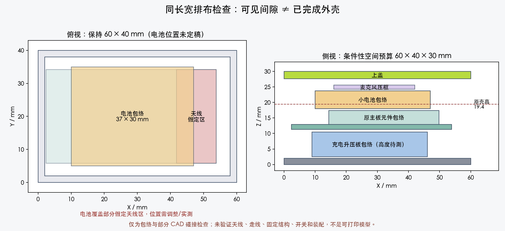

# VOXU 原尺寸电池版设计

日期：2026-09-30。远程 main 已核实为 `81804c4`，包含初代外壳及蓝牙重连改动。

**当前阶段：按用户最新要求重新选型和布局。尚无可直接照焊的完整接线图，也没有电池版打印文件。**

## 1. 当前约束

- 外壳长宽固定 **60 × 40 mm**，保持初代外形；仅适当增加厚度。初代壳体高 19.4 mm，按钮另计。
- 优先利用现有空隙放小电池，容量服从空间；原先 4–6 小时改为参考愿望，不再为满足它扩大长宽。实际续航需测量后报告。
- 保留 ESP32-WROOM-32 30 针开发板、原 USB-C、原串口刷机和自动下载电路、14 mm INMP441 与 BOOT 操作。
- 同一 USB-C 接 MacBook 可充电和刷机，接充电器可充电，拔线自动用电池；支持边充边用和关机充电，不设电脑/充电器模式开关。
- 尽可能覆盖常见 USB-A 与 USB-C/PD 充电器的 5 V 输出，不以高压快充为前提；具体兼容性需验证。
- 优先一块成品充电升压板，不再把定制 PCB、替换 CH340、整套 CC/UART 检测当作既定实施范围。

86 × 96 mm 大模块方案和 72 × 52 mm 定制小板方案均已撤回。上一轮关于接受定制板与原板串口拆改的提问已失效，无需继续回答。

## 2. 除电池之外需要什么

| 项目 | 数量 | 用途 |
| --- | ---: | --- |
| 带保护的单节 3.7 V / 满充 4.2 V 电池 | 1 | 按可用空间、持续/峰值放电能力选型，不只看 mAh |
| 集成充电、负载分配和 5 V 升压的成品板 | 优先 1 | 插线充电并供电，拔线从电池供电；维持原板 VIN 供电方式 |
| 小运行开关 | 1 | 控制系统运行，充电仍保留 |
| 导线、绝缘和固定件 | 少量 | 固定软包，隔开焊点与热源，完成电源改接 |
| 模块充电设定电阻 | 可能更换 1 个 | 将默认大电流降至适合小电池的值 |

这是数量与功能说明，不是已冻结采购单。充电升压板不会自动使原开发板具备电池充电能力；必须区分 USB 输入和升压输出，避免输出回流到 USB。

## 3. 成品板候选

优先复核 **Adafruit PowerBoost 1000C #2465**。它已有负载分配充电和约 5.2 V 升压，可保留原开发板稳压器与串口桥。厂家产品页标注的 23 × 45 × 10 mm 是装上 USB-A 插座后的尺寸，不能据此直接判定装不下。

本轮读取厂家 Rev B EAGLE 文件：PCB Dimension 层范围约 **36.068 × 22.86 mm**。不装散装 USB-A 输出座，使用输出焊盘。板上的 JST、电感、micro-USB 和接线仍占空间；PCB 外形不等于完整装配包络，高度需继续核实。

原理图确认 `R16=1kΩ` 接 MCP73871 `PROG1`，默认约 1 A 充电，不适合本次小电池。拟改为 `10kΩ`，芯片资料在相应测试条件给出约 90–110 mA。这是充电电流设置，**不是 USB 总输入限流**。原板 `SEL` 接 VBUS，默认适配器模式；仅改 R16 不能宣称获得 USB 端口协商或 100 mA 总输入限制。最终接线与电脑供电预算仍需完成。

这一候选此前因 USB 授权与限流问题没有冻结；本轮发现较小裸板尺寸，解决的是机械尺寸判断，并没有解决上述电气问题。若输入预算无法满足目标，不能把它当作已通过方案，也不自动恢复复杂串口替换方案。

其他候选：DFRobot DFR0446 约 35 × 30 mm，但默认大电流与连接器需要额外处理；SparkFun MCP73831/PAM2401 板不凭“充电+升压”商品名认定具备所需负载分配；Waveshare UPS Mini 的 61 × 38 mm PCB 已超过本壳可用长宽，不继续采用。

## 4. 电池与续航边界

500 mAh 参考件 Adafruit #1578 为 **36 × 29 × 4.75 mm**，带保护。其厂家数据表最大持续放电为 1C，即约 0.5 A；它是尺寸与电流参考，尚未定为采购件。

以最低电压 3.0 V、升压效率 85% 估算，这个持续电流上限只能支持约 `3.0 × 0.5 × 0.85 / 5.2 = 0.245 A` 的 5.2 V 输出。必须检查整机负载与启动峰值，不能把升压板额定 1 A 当作小电池也能输出 1 A。参考电池数据表没有提供这里所需的峰值放电保证。

500 mAh 在 5.2 V 平均负载 0.2 A、85% 效率、80% 可用容量的示例续航约 **1.21 小时**。这是假设计算，不是实测或用户承诺；比原 2000 mAh 方案短是缩小电池后的直接结果。更小电池仍需满足放电能力，不能只为并排塞入外壳选择 100/150 mAh。

## 5. 已有空间的实际约束

从初代参数和 CAD 源码计算，数值及厂家 PCB 源文件校验值见 [本轮证据](../research/2026-09-30-original-footprint-evidence.json)：

| 部位 | 当前空间 | 说明 |
| --- | ---: | --- |
| 底板上表面到主板底面 | 2 mm | 底板 z=2，主板底面 z=4；还需扣焊点、托台及绝缘 |
| 主板高元件顶面到可选麦克风压框下缘 | 3.5 mm | 高元件 z=10.1，压框最低 z=13.6；不是整层连续空腔 |
| 主板后缘到后内壁 | 4.15 mm | PCB 后缘 x=53.85，内壁 x=58 |

所以不能只凭外观空隙认定 4.75 mm 电池能直接放入原 19.4 mm 高壳。下一步在 **60 × 40 mm** 内比较“电源板下置、电池利用上方空隙”和“底部薄分层”两种排布，再得到最小厚度，不先承诺未经检查的高度。

- 保留麦克风卡槽形状和 BOOT 功能。上移部件后重算 USB 窗口、卡扣、支撑与按钮；不能只修改壳高。
- 不让支柱、焊脚或卡扣压电池。电池包络需包含保护板、线出口、公差与适当余量。
- 电池与电源板靠近 USB 端，避免覆盖主板远端天线；无法完全满足推荐净空时必须记录并做实际蓝牙距离/录音测试，不能当作射频验证通过。
- 初代 USB 外壳文件保持独立，电池版另建目录；新尺寸与支撑验证后才生成可打印件。

### 条件性空间检查结果

本轮直接加载初代 CAD 的几何构造，在临时目录做包络检查，未修改原外壳、未生成电池版 STL。复现：`python docs/superpowers/research/inspect_fixed_footprint_space.py`（使用现有 CAD Python 依赖）。

- 在原高度放入 37 × 30 × 5.75 mm 电池余量包络，会与麦克风、压框和上盖结构相交；不能直接塞入。
- 主板上移 7.3 mm、上盖与麦克风上移 10.6 mm，可得到 **60 × 40 × 30 mm** 的条件性排布。暂取电源板 37.068 × 23.86 × 8 mm 包络，放在主板下方；电池位于主板上方。相对于已列出的壁面、支撑角台、主板元件、上盖和麦克风，此次实体相交体积为 0。
- 该检查**不是完整装配通过**：电源板 8 mm 高度未经实测，线束/插头、新支撑、按钮、开关和装配路径尚未建模。30 mm 也不是厚度下限或定稿尺寸。
- 当前电池投影覆盖部分假定天线区，距假定天线平面仅约 5.1 mm。不能据此定稿；需调整电池尺寸/位置并确认真实天线边界。Espressif 建议产品内天线周围保留至少 15 mm 空间并测试实际通信距离，[官方依据](https://docs.espressif.com/projects/esp-hardware-design-guidelines/en/latest/esp32/pcb-layout-design.html)。本检查不证明实际信号会失败，也不证明其合格。

[原始检查结果及遗漏项](../research/2026-09-30-fixed-footprint-space-probe.json)与[检查脚本](../research/inspect_fixed_footprint_space.py)保留可复现证据。下一步不能直接把这张占位图导出成最终打印包。

## 6. 原 USB-C 的电源改接

概念连接为：原 USB-C VBUS → 成品电源板输入；保护电池 → BAT；电源板输出 → 原板 VIN；所有地共地。原 USB 数据和自动下载连接保留。

**此图还不能照焊。** 必须先确认实际开发板 VBUS、VIN、串口桥供电及原板隔离二极管/走线。输入与输出不能并在同一网形成充电回路；不能凭照片外形猜测应拆哪个二极管。还需核对拔 USB 或运行开关关闭时 UART 的供电状态与回灌。

兼容性验收分别包含：MacBook C-to-C 充电刷机、USB-A 充电器+A-to-C、USB-C/PD 充电器+C-to-C、插拔、关机充电、低电量启动。模块能接 5 V 不等于上述组合全部已通过。保留已读取的 [USB 描述符证据](../research/2026-09-30-usb-readonly-evidence.json)，不把端口标称能力当作实际授权或功耗测量。

## 7. 下一步与完成标准

1. 锁定模块装配包络、小电池放电能力与原板电源改接；提供可审阅 BOM 和明确接线。
2. 在 60 × 40 mm 内完成部件排布、机械支撑和最小厚度；输出独立参数化 CAD、STL、预览及打印包。
3. 完成几何/按钮/碰撞及 P2S 切片检查，并保留实物尺寸与装配验证项。
4. 实测电脑充电刷机、各类充电器、插拔、关机充电、无回灌、温升、录音与续航。

PR 继续 Draft。当前没有最终电路、打印包或实物验证通过的结论。

## 8. 可追溯资料

- [原 USB 外壳参数](../../../hardware/enclosure/parameters.json)与[CAD 源码](../../../hardware/enclosure/generate.py)。
- [PowerBoost 1000C 产品页](https://www.adafruit.com/product/2465)及[厂家原理图/PCB](https://github.com/adafruit/Adafruit-PowerBoost-1000C)。
- [MCP73871 数据表](https://ww1.microchip.com/downloads/aemDocuments/documents/APID/ProductDocuments/DataSheets/MCP73871-Data-Sheet-DS20002090F.pdf)。
- [500 mAh 参考电池](https://www.adafruit.com/product/1578)及[放电规格](https://cdn-shop.adafruit.com/product-files/1578/Datasheet.pdf)。
- [DFRobot DFR0446](https://www.dfrobot.com/product-1613.html)、[Waveshare UPS Mini](https://www.waveshare.com/wiki/UPS_Module_Mini)。
- [已撤回的定制板方案](../research/2026-09-30-superseded-custom-board-spec.md)，仅供追溯。
