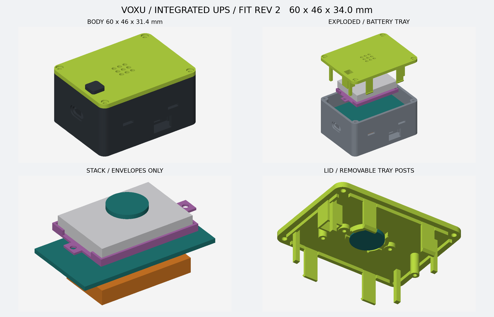
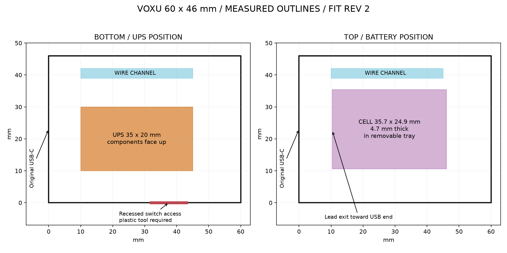

# VOXU 一体 UPS 电池外壳 · 实物适配版 2

外壳 **60 × 46 × 31.4 mm**，含未按下的 BOOT 按钮总高 **34 mm**。相对上一电池壳，宽度增加 6 mm，长度和高度保持；用户已允许约 1 cm 的尺寸调整。本版按收到的一体板和电池尺寸设计，可打印试装；充电电流适配和单 USB 改线仍未验证，不作为带电施工图。原有线版 `hardware/enclosure` 不变。





## 实物与结构

| 零件 | 实测尺寸（mm） | 放置方式 |
| --- | --- | --- |
| 常规款 5V 一体 UPS 板，V1.0 | 35.0 × 20.0 × 5.6 | 底部定位槽，元件朝上、板背朝下；USB 朝原主板 USB 一端，板载开关朝侧面操作口 |
| 3.7V、550mAh 电池 | 35.7 × 24.9 × 4.7 | 上方独立可拆托盘；线从靠 USB 的一端引出 |
| 原 ESP32 开发板 | 51.45 × 28.33 | 原卡扣结构，PCB 底面 z=12mm |
| 原 14mm 圆形麦克风 | 沿用原尺寸 | 上盖中央，声孔朝外 |

实测依据：用户 2026-10-18 提供的 IMG_6657～IMG_6663 卡尺照片；电池容量由用户确认。尺寸不是根据商品宣传图估算。

- 一体板定位空间 **36 × 21mm**，高度包络 **6mm**，底面 z=3.2mm。底部有定位床和断开的定位栏；床面到模块预留 0.2mm 绝缘/胶带空间。需确认板背无突起元件，不以压紧元件来就位。
- 已购 PI 胶带用于背面绝缘与可拆固定。两组底部穿带槽对应 USB 金属座附近和输出端边缘：胶带裁约 3mm 宽，在不压芯片、电感、开关、不覆盖待焊端子的区域固定。必要时先在输出端焊盘上贴绝缘片；不要将焊点顶在底座上。胶带固定效果须试装检查。
- 侧面 **11 × 7.2mm** 开关操作口直通开关一侧。开关距壳外约 10mm，使用细塑料拨棒操作；本版没有推杆，也不是手指可直接拨动的外露开关。位置由照片推定，窗口为容差预留，试装时检查能否拨到 ON/OFF。
- 一体板自身 USB-C 留在内部，无第二个外露 USB 口；仍保留原开发板 USB-C 外部位置。充电/刷机共口接法参见尚未验收的 [接线说明](wiring.md)。
- 电池托盘底厚 **0.8mm**，每边预留 **0.5mm**、上方预留 **1mm**；电池下面留 0.2mm 胶带空间。电池用 PI 胶带松贴在托盘上，不拉紧束缚软包，不靠盖板挤压固定。
- 托盘用 **两枚 M2×4 平尾塑料自攻螺丝**从下方向上固定到上盖柱，螺钉头按直径≤4mm、高≤1.5mm建模。取下上盖时托盘和电池随盖上移，线束需预留服务长度。
- 主板一侧留 **35 × 3mm** 走线通道，从底部到电池层连续通畅。电池出线转到该通道；红黑线分别绝缘，合盖前确认线束未被卡扣/托盘夹住。
- 电池不再覆盖按主板最后 6mm 假设的天线投影，投影间隔约 1.75mm；这不等同于满足天线厂家完整净空，实际无线性能未知。

## 打印

[下载本版六件 STL 和说明 ZIP](voxu-battery-fit-prototype.zip)。文件名沿用旧版，但包内 revision 为 `integrated-ups-fit-2`。所有 STL 单位 mm，落在 Z=0；上盖和按帽已翻面。

| 文件 | 用途 | 支撑 |
| --- | --- | --- |
| `stl/base.stl` | 底座、主板夹臂、一体板定位和开关窗口 | 开启；清理夹臂下方和底部穿带槽 |
| `stl/lid.stl` | 上盖、麦克风座、托盘柱、BOOT 导向 | 关闭 |
| `stl/battery-tray.stl` | 550mAh 电池托盘 | 关闭 |
| `stl/button-cap.stl` | BOOT 按帽 | 关闭 |
| `stl/button-pin.stl` | BOOT 顶杆 | 开启 |
| `stl/mic-clamp.stl` | 可选麦克风压框 | 关闭 |

P2S、0.4mm 喷嘴、0.2mm 层高、3 道墙、15% 填充、Generic PLA 已完成诊断切片。上下盖不要与旧 40mm 宽版本混装。建议先打印底座和电池托盘检查就位，再打印上盖；按钮/压框可核对旧件尺寸后复用。不要为了塞下电池而磨薄其包装或压缩电池。

切片器仍出现 `Invalid T command (T65535)` 日志，虽各件 result.json 均返回 Success，本包只交付 STL，不交付生成的 G-code；请在 Bambu Studio 使用自己的机器和耗材预设重新切片。

## 不带电试装顺序

1. 清理底座支撑，铺背面绝缘；一体板先放底部定位槽，确认开关窗口对齐，再用 PI 胶带固定。
2. 从侧面走线通道预排线束，再放原开发板；四角支撑和侧面卡扣就位，USB 对准原开口。
3. 将电池放托盘，出线靠 USB 一端，松贴胶带固定。两枚 M2×4 螺丝固定托盘到上盖，不压电池。
4. 安装原麦克风、按帽和顶杆，预留开盖线长，合盖检查 BOOT 回弹、卡扣、USB 插头和开关操作。
5. 四角 M2×8 加固螺丝是可选的，可沿用原件；不要用长螺丝替代托盘的 M2×4。

不要求用户重复测量输出电压。机械设计按产品说明和实测外形推进；**板背充电标注与 550mAh 电池是否匹配、原 USB-C 防回灌接线仍未完成**，机械通过不代表可以直接连电池充电。

## 验证与复现

`validation.json` 检查六件封闭网格、正体积、单连通；主板/电池/模块/托盘/螺钉头碰撞、托盘随盖拆出、按键动作、卡扣保持与释放、麦克风通孔、走线通道和开关窗口。电子板用保守包络代替全部小器件，插头伸出和柔性线束未作完整仿真。固定强度、打印公差和实际开关手感需试装。

```sh
uv venv /tmp/voxu-cad-venv
uv pip install --python /tmp/voxu-cad-venv/bin/python -r hardware/enclosure-battery/requirements.txt
/tmp/voxu-cad-venv/bin/python hardware/enclosure-battery/generate.py
/tmp/voxu-cad-venv/bin/python hardware/enclosure-battery/slice.py
# 再生成一次，将最新切片报告打进 ZIP
/tmp/voxu-cad-venv/bin/python hardware/enclosure-battery/generate.py
```
