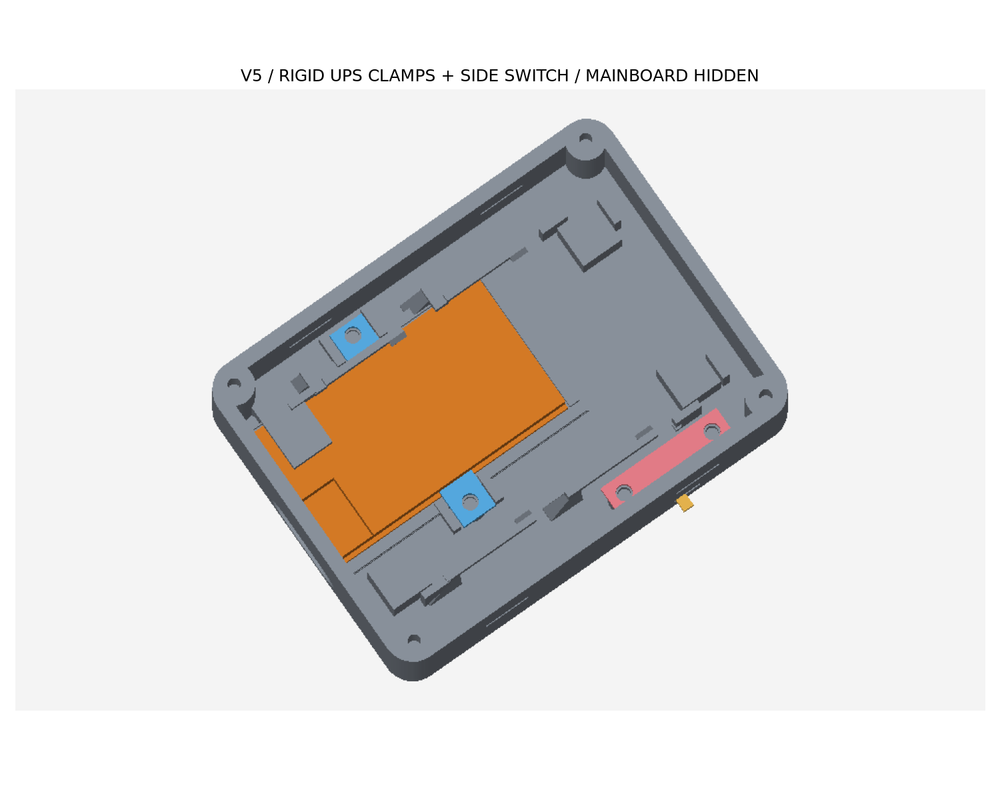

# VOXU 电池外壳 · 硬固定与右侧开关版 5

外尺寸仍为 **62 × 46 × 31.4 mm**（含 BOOT 按钮34mm），UPS 充电口位置不变、ESP32 刷机口隐藏。第6版替换胶带承力方案：USB 插拔力由底壳限位承受，板边压片防止 UPS 翘起；SS12D00G3 安装在右侧独立槽座。

**已有第4版：只重打底壳和三个小压件。上盖、电池托盘、BOOT 按帽/顶杆、麦克风压框与第4版 STL 相同，可复用。** 不兼容更早的40mm宽外壳。

[打开分层 HTML 预览](preview.html)，点击“只看电源层”查看新固定结构。蓝色为两片 UPS 压片，金色为开关，粉色为开关压盖。电子件是几何包络，动画用于观察分层，不代表实际装拆路径。



## 固定方式

- **UPS 底座**：平底床承托 PCB，前后挡边承受插拔力，两侧壁限制横向移动；移除旧穿胶带孔和板载开关工具操作窗。
- **UPS 两片压片**：每片厚2mm、宽5mm，各用一枚 M2×4 平尾塑料自攻螺丝固定；配导向壁防止绕螺丝转动。只搭住 PCB 两侧各0.45mm板边，不压芯片、电感、电容。按用户实测 PCB 厚1.4mm，压片下留0.25mm装配间隙。
- **开关座**：右侧指“面对前端充电口看入盒内时的右侧”，对应模型 y=0。SS12D00G3 本体横放，柄向壳外；槽座挡住本体，独立压盖用两枚 M2×4 固定，焊脚不承受拨动力。
- **开关尺寸**：采用用户提供的本体8.6×3.6×3.5mm、柄长3mm。商品图标本体8.5×3.5×3.5mm、柄截面1.5×1.5mm、行程2mm、脚距2.5mm、含脚总长7.2mm；槽按较大的用户尺寸每边留0.2mm。开口4.1×2.1mm，柄名义外露1.8mm。3个焊脚朝内，留焊接与绝缘空间。
- **拆修**：先取出 ESP32 主板，再卸压件。外侧 UPS 压片卸螺丝后轻抬并向侧壁退约0.9mm，再向上取出，避开原主板夹臂；内侧压片和开关压盖向上取出。

开关图来自[跃一电子 SS12D00G3 商品详情](https://mobile.yangkeduo.com/goods.html?goods_id=702019867703)，2026-10-18 浏览核对。其 0.5A / 50V AC 标注不等同于本机直流功率线适用性；外置开关接 SW/G 已由用户验证启停可用，不直接把小开关串入电池或5V功率线。

## 第6版方向修正

以元器件面朝上、USB口朝上俯视：USB在PCB左侧，因此UPS主体放在中央充电开口的右侧。第5版偏置方向错误，不应通过翻面安装补救。

用户实测 PCB 右边缘到 USB 金属外壳右边缘为11mm。PCB宽20mm，接口金属壳宽暂用8.94mm参考值：接口中心距PCB左边缘4.53mm；为对准46mm宽外壳的中心23mm，PCB横向范围为18.47–38.47mm。原范围8–28mm已改正。接口壳宽每变化1mm，定位中心相应变化0.5mm；现有14mm宽外壳开口保留余量。高度继续沿用此前参数。

本次重新打印 **底壳及两片UPS压片，共3件**。上盖、托盘、按钮、麦克风压框和侧开关压盖保持原件。压片沿用旧文件名，`ups-clamp-right`为新外侧压片，`ups-clamp-left`为新内侧压片，以当前预览和螺丝孔定位为准。外侧压片缩短以保留0.9mm向外拆卸行程；主板底部支撑同步避让元器件。

## 打印和螺丝

[完整 STL、预览及说明 ZIP](voxu-battery-fit-prototype.zip)，包内 revision 为 `integrated-ups-fit-6`。所有 STL 单位mm、已落在Z=0。底壳正放，UPS压片平放，开关压盖已翻面导出（平面朝下、后挡脚朝上）。

| 文件 | 是否本次需要打印 | 支撑 |
| --- | --- | --- |
| `stl/base.stl` | 是：UPS方向修正的底壳、挡边和底床 | 开启，清理主板弹臂和开关槽内支撑 |
| `stl/ups-clamp-right.stl` | 是：UPS外侧压片（靠壳壁） | 关闭 |
| `stl/ups-clamp-left.stl` | 是：UPS内侧压片（靠中心） | 关闭 |
| `stl/switch-retainer.stl` | 第5版可复用，未改变 | 关闭 |
| `stl/lid.stl` | 第4版可复用 | 关闭 |
| `stl/battery-tray.stl` | 第4版可复用 | 关闭 |
| `stl/button-cap.stl` | 第4版可复用 | 关闭 |
| `stl/button-pin.stl` | 第4版可复用 | 开启 |
| `stl/mic-clamp.stl` | 第4版可复用 | 关闭 |

新增固定件使用 **4枚 M2×4 平尾塑料自攻螺丝**，不占用电池托盘已有的2枚。头径≤4mm、头高≤1.5mm。不要用长螺丝替代，也不要过度拧紧塑料柱。

诊断配置为 P2S / 0.4mm 喷嘴 / Generic PLA / 0.2mm层高 / 3道墙 / 15%填充。最终结果见 `slicer-result.json`。切片CLI可能记录 `Invalid T command (T65535)`，仅交付 STL，不提供G-code；在自己的 Bambu Studio 配置中重新切片并检查支撑。

## 断电试装顺序

1. 清理底壳支撑和压片孔。断开电池和USB，把 UPS 元件朝上放入定位床，Type-C 朝前端开口，确认能平放且不强压。
2. **先看两个压片落点**：不得碰元件、焊锡凸点或导线。CAD只在这两处预留板边0.6mm元件禁入带，来自照片，不能保证实际焊点净空。若有干涉，停止拧紧，调整压片而不是压元件。
3. 安装左右压片，螺丝拧至压片坐稳导向座即可；板边允许小量装配间隙。试插USB，确认板不退出/翘起、插头能插到底。
4. 独立开关先完成必要引线焊接和绝缘，再将柄对准侧孔、从壳内水平推入槽座，焊脚朝内。用两枚螺丝固定压盖；确认两档均能拨到底。本体应受槽壁支撑，不能靠焊脚顶住。
5. 排线，再装 ESP32、原电池托盘和上盖。侧边原走线通道保留，线束留开盖余量。电池仍在独立托盘内，不能靠壳盖挤紧。

外部开关接 SW/G 已由用户实测确认启停可用，动态接线页已增加三脚接线详图。板载开关档位尚未记录，充电电流匹配及反向隔离仍未确认，刷机仍保留 J1；详见 [wiring.md](wiring.md)。

## 验证范围

`validation.json` 检查九件网格封闭/单连通/正体积、零件和电子件包络干涉、4枚新螺钉头、UPS和开关六方向限位、柄2mm行程、开关水平装入、压片/压盖拆出、原按键和卡扣运动、托盘拆出及走线净空。**没有做受力仿真或实物强度验收**；软线弯曲与焊点外形未完整仿真。USB偏置按用户实测右边缘间距11mm修正；接口壳宽8.94mm为参考值，尚不是实测。

```sh
uv venv /tmp/voxu-cad-venv
uv pip install --python /tmp/voxu-cad-venv/bin/python -r hardware/enclosure-battery/requirements.txt
/tmp/voxu-cad-venv/bin/python hardware/enclosure-battery/generate.py
/tmp/voxu-cad-venv/bin/python hardware/enclosure-battery/slice.py
# 把最新切片报告纳入 ZIP
/tmp/voxu-cad-venv/bin/python hardware/enclosure-battery/generate.py
```

## 网页螺丝展示

3D 装配页增加12枚金色十字头螺丝，按用途合并为5组显示选项，复用 CAD 孔位坐标；点击“螺丝孔位”进入分层视图。“只看电源层”包含 UPS 压片和开关压盖的4枚螺丝。托盘与麦克风压框螺丝从下向上，四角上盖螺丝从上向下。8枚 M2×4，4枚可选 M2×8；模型以直径4mm、高1.5mm头部和无螺纹杆简化展示，未新增打印零件，未改变孔位或外壳尺寸。

## 元件面和接口标记

网页提供“元件位置”分开展示UPS与ESP32，仅便于位置对照，不代表实际装配间距。USB接口直接显示“USB-C 充电 / USB-C 刷机”。两块板各增加6个凸起元件示意，包括插座、开关、电感、芯片、屏蔽罩、按钮和天线区；关键元件可单独悬停高亮并显示名称。原7条标线默认隐藏，可手动开启。USB金属壳为参考外形；电池座和板载开关为照片位置示意，不能作焊盘定位依据。
