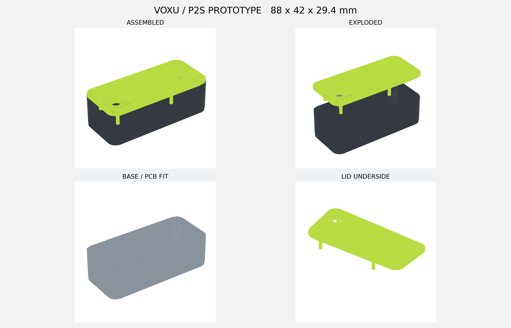

# VOXU P2S 有线外壳试装版

本版用于 **拓竹 P2S**，只装 30 针 ESP32 DevKit V1 风格开发板、圆形 INMP441 和接线；无电池仓、无电源开关。上盖按压件通过独立顶杆触动原有 BOOT，实现固件已有的开始/结束操作。

**这是可打印的试装版，尚未完成实物装配验收。** 用户确认的尺寸是开发板 51.45 × 28.33 mm、麦克风圆板 14 × 14 mm。PCB 厚度、按键高度/行程、排针与插线高度、接口外壳位置尚未实测，因此不能将网络平面图当成完整机械图。



## 下载与零件

`voxu-p2s-prototype.zip` 包含 STL、参数、源代码和本说明。STL 单位为 mm，各文件均已落到 Z=0。

| STL | 数量 | 用途 |
|---|---:|---|
| `base.stl` | 1 | 底座、四角 PCB 托台、线缆开口和外侧握持凹槽 |
| `lid.stl` | 1 | 亮色上盖、两条护脊、拾音孔、麦克风定位圈和 PCB 压柱 |
| `button-cap.stl` | 1 | 外部按帽和导向轴，肩部提供向下限位 |
| `button-pin-standard.stl` | 1 | 标准顶杆；下端对准 BOOT，上端插入按帽 |
| `button-pin-short.stl` | 备选 | 比标准顶杆短 0.4 mm，适合按键被持续压住的情况 |
| `button-pin-long.stl` | 备选 | 比标准顶杆长 0.4 mm，适合按不到的情况 |
| `board-fit-test.stl` | 先印 1 | 完整 PCB 长宽定位、托台与 USB 窗口下部试装 |
| `button-guide-test.stl` | 先印 1 | 按帽导向配合测试，厚度与上盖相同 |

外廓约 **88 × 42 × 29.4 mm**。底壁/侧壁 2 mm，上盖 2.4 mm。PCB 放在 10 mm 高度，底板上方留出约 8 mm 排针与走线空间。若杜邦母头和线材超出此空间，需要修改参数后重新生成，不能强压合盖。

## 尺寸依据和待核对参数

- 开发板平面参考：[ESP32_dimension.png](https://embedded-systems-design.github.io/overview-of-the-esp32-devkit-doit-v1/ESP32_dimension.png)。用户已确认板体长宽；不依赖图中未完整给出的安装孔坐标。
- 麦克风参考：[INMP441 模块尺寸图](https://components101.com/sites/default/files/inline-images/INMP441-Dimensions.jpg)。用户已确认圆板 14 mm。
- USB 朝壳体 X=0 端，天线朝麦克风一端；从元件面向下看、USB 朝左时，BOOT 在图纸下侧。本版 BOOT 中心暂按 PCB 左下角向内 (3.1, 6.0) mm，由参考图估计，**不是用户实测坐标**。
- `board_thickness=1.6`、`boot_height_above_pcb=3.2` mm 为试装假设。
- USB 窗口为 14 × 9 mm；它给整根插头外壳留空间，不假定实物一定是概念图中的 USB-C。
- 按帽导向直径 6.8 mm / 孔径 7.4 mm；按帽与顶杆连接为 3.0 mm 轴 / 2.9 mm 孔的试配合，必要时轻修孔或用极少量胶粘合。
- 按帽肩部到盖面的初始间隙 0.6 mm，顶杆到假设按键面的初始间隙 0.3 mm。名义剩余开关压缩量 0.3 mm，**实际开关行程未验证**。顶杆松配时会在重力作用下落到按钮表面；本版没有独立回位弹簧，回位依靠 BOOT 自身弹力。

## P2S 打印建议

以下是首轮试装建议，不是经实机验证的预设：0.4 mm 喷嘴、PLA、0.20 mm 层高、3 道墙、4 层顶底、15–20% 填充。可用 PETG，但配合尺寸需要重新验证。黑色底座、亮色上盖可分别打印，不需要 AMS。

1. 在 Bambu Studio 中选择自己实际的 **P2S、喷嘴和材料配置**，将各 STL 作为独立对象导入，单位为 mm。
2. 先印 `board-fit-test`、`button-guide-test`、按帽和标准顶杆；验证板体落位、USB 插头能插到底、BOOT 对位和导向运动。试装托盘只包含 USB 窗口的下部，完整插头高度仍需检查最终底座。
3. 底座/试装托盘已按底面朝下导出；USB 横梁需要检查桥接，必要时仅为窗口加支撑。
4. 上盖已倒置导出。护脊造成悬空区域，**上盖需要支撑**；建议树状支撑并在切片预览检查两条护脊之间的盖面和螺钉孔。不要直接无支撑打印。
5. 按帽顶面朝下导出，通常无需支撑；顶杆按轴向导出，挡边有悬挑，需支撑。清理后检查轴与孔是否能自由滑动。
6. 先看切片逐层预览再打印；提供的是几何 STL，不含未经验证的打印机 G-code。

## 装配

额外材料：4 枚 **M2 × 10 mm 塑料自攻螺钉**（头径不大于 4 mm），少量薄双面胶；无需电池、电源开关或新增电子按键。

1. 断电。将接线布置在板下，开发板元件面朝上、USB 朝端部窗口。PCB 四角坐在托台上，排针不得顶到底板。上盖四个压柱与托台对应，名义留 0.25 mm 间隙。
2. 麦克风圆板装入上盖内侧定位圈，**PCB 声孔朝向上盖拾音孔**，金属麦克风封装朝内部。在 PCB 声孔两侧的空白处用约 0.4 mm 薄双面胶固定；不要覆盖声孔。两侧开窗供引脚/细线通过，接线方向若与开窗不符需旋转模块或修改定位圈。模块不靠摩擦圈单独承重。
3. 从上盖内侧放入顶杆，从外侧插入按帽，压合 3 mm 连接轴。不要将胶带/胶水带入导向孔。挡边在盖内，按帽肩部在盖外，两者共同限制行程。
4. 不接电时先试按。应自由回位、不压到 EN、松手后不持续压 BOOT。若按不到用较长顶杆；若持续压住用较短顶杆。若三种长度均不合适，测量后调整 `boot_height_above_pcb` / `button_initial_gap`，不能靠拧紧外壳强行触发。
5. 合盖后用 M2 自攻螺钉轻拧入底座 1.7 mm 导孔。螺钉头从上盖可见：本试装版优先可拆装，暂未实现概念图的隐藏卡扣。
6. 确认松手状态下 BOOT 未受压，再插电；上电按住 BOOT 会进入下载模式。验证开始/结束操作、回弹和麦克风录音。

不设虚假的状态灯透光件。本版仅保留实际需要的拾音孔与 BOOT 操作。麦克风与天线在同一端的射频/拾音表现需实测，定位圈与线材不得压在天线区域。

## 再生成及验证

需要 Python 3.11 或更新版本（本次生成使用 Python 3.14）：

```sh
python3 -m venv /tmp/voxu-cad
/tmp/voxu-cad/bin/pip install -r hardware/enclosure/requirements.txt
/tmp/voxu-cad/bin/python hardware/enclosure/generate.py
```

修改 `parameters.json` 后执行生成器。`validation.json` 记录每个 STL 的尺寸、体积、封闭性、连通性，以及板体/上下壳/按钮的名义装配碰撞检查。验证没有模拟 PCB 上全部器件、线材、材料收缩或真实按键力学；实物装配与 P2S 打印仍待用户验证。
