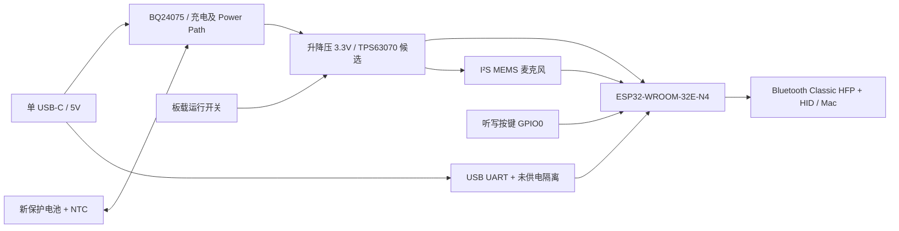

# VOXU 集成主板：立创 EDA 专业版设计草稿

2026-10-23 最新要求：**1 块焊接完成的 PCBA**，使用立创 EDA 专业版；优先 INMP441，元件控制成本，新电池另计，查询实际总价但不付款。原两块主备要求已被替代。

**当前不是生产文件。** 64 器件整板电气草稿见 [A2 说明](electrical-design-a2.md)。现有 KiCad 文件用于迁移，后续以专业版工程完成封装绑定、布局布线和检查。尚无完成的 PCB、Gerber 或贴片坐标，因此未取得实际工厂总价。

A2 USB 桥候选已改为 CP2102N；下方 A1 记录中的 CH340C、两块预算及40.62元核心合计均为历史方案，不代表当前 BOM 或报价。INMP441 国内 SMT 页面显示库存0、预订参考58元/颗，交期未确认。最低裸板批量、最低贴片数量及损耗备料需在实际订单中确认，不能把批次费用直接除以数量当作单块下单总价。

## 专业版迁移结果

已导入并保存私人工程 `VOXU-A2-整板设计草稿`。64个器件的值及已有LCSC字段与本地清单一致；已绑定45个阻容及ESP32、INMP441共47个封装候选；专业版原理图DRC仍报告17项缺少封装，阻止网表导出。网络逐引脚一致性尚未验证。源码快照及检查记录见 `lceda-pro/`；源码快照不包含符号库，不能当作完整工程包。

下一步必须完成真实器件及封装绑定、原厂焊盘核对、网络复核，再布局布线。当前没有可报价生产文件，也没有付款。

## A1 历史设计记录（供追溯，不用于下单）

## 电路架构

采用带天线模组，不自行设计 ESP32 裸芯片射频匹配。USB 仅作电源与串口下载，音频继续通过蓝牙。保留 GPIO26=BCLK、25=WS、33=DIN，首版保留 GPIO0 听写行为和下载用途；开机按住仍会进入下载模式。增加独立 EN 复位键及测试点。

## 候选选型与供货依据

以下是网页快照，不是预留库存；国内嘉立创 SMT 状态优先于国际站价格。所有替换均需重新核对原厂引脚和封装。

| 部分 | 候选 | 料号 / 证据 | 决策 |
| --- | --- | --- | --- |
| MCU | ESP32-WROOM-32E-N4 | C701341；商城标注 SMT 扩展库、嘉立创库存 31K+；1+ ¥22.97 | 首选；4MB Flash，延续 Classic 蓝牙 |
| UART | CH340C | C84681；商城标注 SMT 扩展库、嘉立创库存 117K+；搜索价 1+ ¥3.60 | 候选；供电与信号隔离需设计 |
| 充电 | BQ24075RGTR | C15464；商城标注 SMT 扩展库、嘉立创库存 15K+；1+ ¥6.57 | 首选架构候选；有 Power Path |
| 稳压 | TPS63070RNMR | C109322；国内商城标注 SMT 扩展库、嘉立创库存 38K+；1+ ¥7.48 | 候选；输出设 3.3V，完整外围待设计 |
| 麦克风 | INMP441 | C5438445；国内商城标注 SMT 扩展库，但无可靠价格/现货数量 | 用户指定首选；直接贴芯片，不焊接原模块 |
| 缺货备选 | MSM261S4030H0R | C2840615；搜索参考价 ¥7.65，不是确认下单价 | 仅在 INMP441 无法采购贴装时评估，需改封装并验证 |
| 电池 | 1S / 满充 4.2V，约 500–800mAh | 尚未锁定供应商型号 | 保护电路、NTC、允许电流、插头极性必须有规格 |

BQ24074 国内商品页显示无现货，不作为首选。BQ24075 与 BQ24074 的系统输出及引脚功能不同，不能照抄原理图。TPS63031 在升压模式的输出能力和输入电压裕量需要谨慎核定，本稿改以输入范围更宽的 TPS63070 为候选，并未将其外围定版。

## 电源设计约束

- 充电、系统负载分配、3.3V 调节分开定义，不把电池直接接 3V3，不再先升到 5V 再经开发板线性降压。
- USB-C 为 5V sink；CC1/CC2 分别设置 Rd。电流预算必须包含 UART、系统和电池充电。两个 Rd 不等于获准任意取电。
- USB 默认、枚举后、休眠、C-to-C 电源能力、A-to-C 连接的限流控制方案尚未冻结。不能简单将充电芯片固定 500mA 后宣称符合所有电脑端口要求。必要时增加 CC/端口检测及可控限流逻辑。
- 充电电流初始设计目标 100mA，最终按新电池规格、ISET 公式和公差核定；100mA 不是 USB 总输入电流。新电池需提供温度监测，避免用固定电阻冒充电芯温度。
- 运行开关控制系统稳压 EN，充电部分持续工作。BQ24075 SYSOFF 仅切电池支路，不能单独保证插 USB 时系统关机。
- UART 候选使用 USB 派生供电，通过具备断电高阻能力的接口隔离到系统域；TX/RX/DTR/RTS 全部检查。隔离器具体料号、OE、下载双管逻辑尚待完成，禁止用串联电阻当作完整隔离证明。
- 至少按 3.3V / 0.6A 峰值进行电源预算及瞬态验证，再据 ESP32 实际负载定版。3.0V 电池、85% 效率下，0.6A 输出对应约 0.78A 电池电流；电池放电能力须覆盖此值与余量。
- 预留 USB、BAT、SYS、3V3、GND、EN、GPIO0、TX/RX 测试点；测试点不用用户焊线。

## 主板与外壳布置意图

首版布局目标为约 55 × 40mm，优先评估双层板、单面贴装，最终尺寸以封装和净空检查为准。此尺寸是设计目标，不是已验证布局。

| 区域 | 布置 |
| --- | --- |
| 后缘 | ESP32 模组天线靠板边，按原厂净空；不允许电池、铜皮、金属紧固件进入天线禁区 |
| 前缘 | USB-C、ESD、充电管理；电感与麦克风分离 |
| 前侧角 | MEMS 麦克风及声孔，避开按钮撞击位置；用外壳声道连到外界 |
| 中央 | 顶部听写键；保证按压力经支撑传递而非压弯板子 |
| 侧缘 | 板载滑动开关及电池插座 |
| 板下 | 绝缘电池托盘，避开声孔、焊点和天线区，包含膨胀与装配余量 |

双层布局意图：顶层放元件和主要信号，底层尽可能保持连续地，仅少量短线。若回流路径、电源热布局或布线无法满足要求，再采用四层；按实际工厂报价比较总费用，不能保证双层一定更便宜。天线禁区对所有层生效。USB 差分线按实际叠层阻抗设计。没有要求盲埋孔或特殊板材；是否需要双面贴装随真实布局确认。

INMP441 与敏芯微备选不共用封装；ICS-43434 移出当前选型。本稿不使用所谓兼容万能焊盘；选型冻结后只采用一个准确封装。声孔按原厂 footprint 和回流/清洗要求制作，外壳需做声学密封，不能只在壳上任意开孔。

## 成本控制与每块价格（A1）

- 保留当前 ESP32 模组，避免改用裸芯片增加射频设计和返板风险。
- 先保留已有价格依据的 BQ24075 + TPS63070（两颗共 ¥14.05/板），比较时计入电感、外围和上料费用；不以取消 Power Path 或低电量稳压能力换取账面降价。
- CH340C 参考 ¥3.60/板，先保留自动下载能力；不为几元改成需要用户另买下载器的方案。
- 电阻电容尽量复用嘉立创常用料号，优先 0603，控制独立料种与贴装面数。USB-C、开关和电池座优先机器可贴装型号。
- 无屏幕、扬声器、第二麦克风、PD 快充、电量计芯片或外部天线；保留必要 ESD、充电管理和电池保护。

四颗非麦克风核心器件参考合计 **¥40.62/板**。当前总物料应写成 `40.62 + INMP441 实际价格 + 外围元件`，未知价格不能记作零。若最终采用敏芯微并取得 ¥7.65 的实际价格，条件性核心合计为 ¥48.27/板；尚不含外围及加工。

按原明确需求保留两块成品；展示单块成本便于比较，并未因之前含糊的数量表述擅自取消备用板。工程费/上料费按批次单列，不把两板费用简单除二当作单板下单价。

## A0 历史预算（当前未重新报价）

这是工程预留区间，不是嘉立创报价，不包含设计服务费；不要据此承诺最低价格。准确费用必须在完整 BOM、坐标、PCB 工艺确定后匹配报价。

| 项目 | 两块预算 | 性质 |
| --- | ---: | --- |
| 两套电子物料 | 180–300 | 估算；含麦克风、电源、接口、无源器件，未冻结 |
| 裸板批次 | 30–100 | 预留；裸板可能有最小数量，未假定仅购两片 |
| SMT 工程/上料/焊接/损耗 | 80–250 | 预留；单面优先，扩展料费用与最少贴片数待确认 |
| 运输 | 15–30 | 预留 |
| 主板首轮合计 | **305–680** | 未含电池与外壳；不是实时报价 |
| 两块新电池 | 40–100 | 预留；尚无供应商报价 |
| 含电池首轮合计 | **345–780** | 不含外壳、测试夹具、工厂烧录/功能测试及第二轮改板 |

以下历史合计包含已移除的 ICS-43434，不再作为当前选型费用。最低采购量、SMT 损耗备料、扩展库收费可能增加实际成本。网页宣传的免费板或低焊点价不计入保证优惠。

两块均需完成上电和音频测试才可称为主备成品。PCB/SMT 两片起订条件尚未证实，不擅自增加成品数量。若最低数量或报价超出上述预留范围，先提供明确差额再决定采购。

## 尚未完成的交付

- [x] 用户要求、架构、供货线索和费用模型。
- [x] INMP441 优先、敏芯微仅缺货备选，以及单板/批次费用分离。
- [ ] 嘉立创国内 SMT 核实全部关键器件；锁定新电池、插座与极性。
- [ ] 冻结 USB 取电和 UART 断电隔离方案，逐引脚原理图、精确 BOM。
- [x] 建立可编辑 INMP441 子电路源文件及网络检查。
- [ ] KiCad 原生打开、ERC、完整主板工程（KiCad 安装下载进行中）。
- [ ] PCB 布局布线、封装复核、ERC/DRC、外壳干涉与天线净空检查。
- [ ] 输出 Gerber、钻孔、BOM、坐标、装配图，并取得两块的实际报价。
- [ ] 样板电源切换、关机充电、低电量启动、刷机、16kHz 录音、按键、重连、续航与温升实测。

PR 在以上设计与检查完成前保持 Draft。本目录不包含可下单文件，不替换现有硬件/固件的验证结论。

## 来源（2026-10-23 查询）

- [ESP32 国内价格及 SMT 状态](https://item.szlcsc.com/736349.html)
- [CH340C 国内商品及 SMT 状态](https://item.szlcsc.com/85852.html)
- [BQ24075 国内价格及 SMT 状态](https://item.szlcsc.com/16143.html)
- [BQ24074 缺货页](https://item.szlcsc.com/55331.html)
- [ICS-43434 国内商品](https://item.szlcsc.com/6577565.html)
- [INMP441 候选](https://www.lcsc.com/product-detail/C5438445.html)
- [TPS63070 候选](https://item.szlcsc.com/110543.html)
- [BQ24075 原厂](https://www.ti.com/product/BQ24075)
- [TPS63070 原厂](https://www.ti.com/product/TPS63070)
- [ICS-43434 原厂数据手册](https://invensense.tdk.com/wp-content/uploads/2016/02/DS-000069-ICS-43434-v1.2.pdf)
- [ESP32 天线布局](https://docs.espressif.com/projects/esp-hardware-design-guidelines/en/latest/esp32/pcb-layout-design.html)
- [嘉立创贴片下单](https://www.jlc-smt.com/order)：需关联 PCB 并提供 BOM/坐标，匹配后计价；本轮未上传文件、下单或付款。

## A1 麦克风电路

详见 [电路说明](microphone-design.md)。首版 CHIPEN 固定接 3V3，沿用固件的停时钟待机行为；不把停时钟当作麦克风掉电。新的原理图仅覆盖麦克风子电路，不能作为完整主板下单。

### 子电路文件与复现

- [KiCad 子电路原理图](schematic/microphone.kicad_sch)，内嵌符号，封装待确定。
- `python3 hardware/integrated-pcba/schematic/generate.py` 重生成。
- `python3 hardware/integrated-pcba/schematic/check_connections.py` 检查 13 个引脚和五个网络、去耦、下拉及意外短接。该检查通过，但不等同于 KiCad ERC 或封装/实物验收。

INMP441 国内页面仍只返回 SMT 扩展库标记，未取得可靠现货/售价；没有把它标成已能下单，也没有自动替换为敏芯微。
