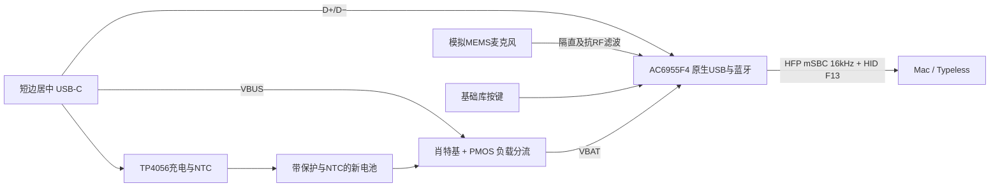

# E2：重选主控和电源的经济型候选

2026-10-24。两块全部厂家焊好，主板合计上限160元，新电池另计，不付款。
**这是架构与选型评估，尚非完成的原理图/PCB，没有制造文件，也没有整板成交报价。**
E1保留了过多收费芯片，不再把E1的220元换料费方案作为降本结果。

## 整套方案的变更

| 功能 | E1 | E2候选及核查状态 |
|---|---|---|
| 蓝牙音频和F13 | ESP32-PICO-V3 | AC6955F4，C22440783，QSOP24；官方SDK有HFP、HID、mSBC；尚未移植或实测Mac兼容性 |
| 麦克风 | SPH0655数字麦克风 | MSM381ACBA01，C51928213，模拟MEMS，目录63.5dB SNR；直接进入主控MIC ADC；供电范围/声孔/焊盘仍须原厂手册确认 |
| USB下载 | CP2102N及三颗SN74隔离 | 主控原生USB；删除这四颗收费芯片；首次下载工具、密钥和供应渠道尚未确认 |
| 电池供电 | TPS63031及功率电感 | 主控VBAT接受电池电压，删去升降压芯片和电感；USB/电池通过免换料PMOS、肖特基分流 |
| 充电 | BQ24075 | 优先评估免换料TP4056与独立负载路径，保留电池NTC；不能把系统负载直接并在充电BAT端后宣称终止正常 |
| USB保护 | 收费ESD阵列 | C7420376 SRV05-4，免换料；引脚、钳位与USB完整性待核 |
| 开关 | 收费拨动开关 | 基础库按键，长按软关机；这是软关机而非物理断电，须测待机电流和充电唤醒 |
| 接口和机械 | USB-C、电池插座 | 保留USB-C短边居中、带插头电池、全顶层贴装；不能删掉插座让用户自己焊线 |

该电源拓扑仍须核定USB枚举/挂起电流、CE默认状态、无电池启动、关机充电、拔插瞬态及NTC开短路行为。不得因为器件免换料而跳过这些条件。主控原生充电也是备选，但参考电路未证明满足本项目的NTC和负载分流要求，暂不以删掉外部充电器作为已实现节省。

## 功能证据与移植工作

已读取官方[AC695N SDK](https://gitlab.zh-jieli.com/soundbox/novisualization/ac695n_soundbox_sdk)，分支 `sdk_3.1.2`，提交 `db6737a030c01d3fef6e8045cf7c8c6df62def6e`。

- `apps/soundbox/board/br23/board_ac6955f_headset_mono/board_ac6955f_headset_mono_cfg.h` 同时启用HFP/HID，启用mSBC编码，时钟24MHz。
- `apps/common/third_party_profile/jieli/hid_user.h` 提供自定义ReportMap及发送报告接口。默认演示不能当成F13键盘，需要移植键盘描述符、按下/释放及断线处理。
- SDK存在充电、掉电保存、蓝牙连接逻辑；还需要实现本产品的最近主机HFP/HID重连、SCO断开停止采音、Typeless按键行为。
- SDK工具链面向Linux/Windows。本机尚未构建目标固件，未生成可烧录镜像，不能承诺现成ESP32固件直接运行。
- 所读耳机配置的 `CONFIG_FLASH_SIZE` 是1MiB；AC6955F4选型必须另核实Flash容量并裁剪无用播放器功能、检查链接后镜像大小，不能直接照抄默认配置。
- [代理商SDK说明](https://gitcode.com/yunthinker/AC695N_Soundbox_SDK)提示不同渠道芯片可能与烧录密钥不匹配。这不等于嘉立创现货一定不能烧录；C22440783的密钥、首次USB下载和代烧录费用必须询问供应商。用户明确要求仅继续查公开资料，不联系供应商；尚未发送任何咨询，密钥兼容性仍未知。

参考[AC6955F4数据手册](https://atta.szlcsc.com/upload/public/pdf/source/20240603/59E76FBF8DC4A2E542D396B107303D06.pdf)和[标准参考原理图](https://www.yunthinker.com/static/upload/file/20241231/1735632259137613.pdf)：VBAT支持2.2–5.5V；原生MIC/USB/LDO可用于上述删减；晶振参考为24MHz、12pF、初始频差±10ppm。SDK时钟枚举的“12–26MHz”不能单独证明12MHz可运行蓝牙，暂不将免费12MHz晶振冒充已验证替代。

## 费用核查结果

`selection.csv`列出当前大项、国内SMT匹配窗口实时价格、损耗及最小贴装量。查询没有点“选用这个元件”，没有改动旧板制造映射。窗口依附旧R18行，需求量为20，因此下面是按两板重新计算的采购预算，仍须新BOM确认，不能当作新订单最终结果。

收费料号预计由E1的11种降到5种：主控、麦克风、24MHz晶振、USB-C、电池插座。其余新电源器件选择官方免换料清单中的料号。**预计换料费100元，而不是220元，也不是零。**

以当前选定的五个收费料号，先计算一个用于淘汰方案的保守下界：

| 项目 | 两块合计/元 |
|---|---:|
| 五种收费料号上料 | 100.00 |
| 经济型工程费，未取得SMT减免券 | 50.00 |
| 主控，2×4.37 | 8.74 |
| 麦克风，2×1.447 | 2.894 |
| 晶振C7420736，最低5×0.379 | 1.895 |
| USB-C，2×1.051 | 2.102 |
| **以上小计，仅为下界** | **165.631** |

即使给PCB、电池插座、电源器件、阻容、焊点、运费和所有其它工序都假设免费，这个选料组合已经超过160元。此处只用于否决该组合，**不是将遗漏项按零计入“完整价格”**。`cost-audit.json`将完整总价保持为null，并逐项记录未取得的费用。

因此此24MHz裸芯片候选不能按当前价格放行，继续画完它的板不能解决预算。它也不证明所有其他架构都不可能。真正可能进一步跨过预算线的条件是：验证免换料晶振可用，或找到可刷写且整合更多功能的模块/实际加工减免；不能再靠换几颗阻容作结论。

## 另外两条路线没有混入已确认节省

1. **DYWH-LYAC6956C模块，C52975839**：现货23，单价16.23、两片32.46。带晶振/天线，可少一种收费器件，但常规4种上料80+工程50+模块32.46=162.46，尚未算其它物料就超上限。[模块规格书](https://atta.szlcsc.com/upload/public/pdf/source/20251224/C59EC0F619A26583C6D2A2B2E5BD2C2B.pdf)还说明LDO_IN、VDDIO没有引出，不能直接沿用裸芯片的原生充电/供电接法。其固件可改性也未确认。
2. 模块目录显示标准包装1pcs，整包价14.9316。如果平台确认该包装满足[整盘购买上料5元规则](https://www.jlc.com/portal/server_guide_22260.html)，四类上料可能65元，模块两片29.8632，工程50，合计144.8632，剩15.1368容纳所有其它费用。**这是有条件的待核路线**，没有购买、没有核销优惠、没有证明两块全包小于160。裸芯片整管50片需142.14元，仅采购即不适合两板预算。

将当前表中的麦克风、USB、电池插座、充电器、PMOS、肖特基、ESD也计入该模块假设后，已知大项加上工程/上料就为156.8012元，仍未包括阻容、PCB和加工余项。模块还可能需要外置麦克风电源，因为VDDIO未引出。因此不能把144.86元当作两板全包价。三针电池插座已改为待验证候选 C52204916，最低两只合计0.314元，原C160353最低五只7.72元；节省7.406元但不减换料种类。仍需匹配带NTC的新电池插头、封装与回流条件。尚没有合格且实价≤160元的结果。

更便宜的AC6082/AC6084目录仅为MP3音频处理，未找到满足HFP/HID的蓝牙证据，不能用来替代本产品主控。低价驻极体型号也不能仅凭“SMD”标签便假设可回流焊且音质等效。

## 完成与未完成边界

已完成主控/USB/音频/电源的整套替代分析与大项实价核对，保存可复算的预算下界。尚未完成电气设计、固件移植、封装、布线、原生ERC/DRC/DFM及新整板最终报价。没有将A2的旧3D预览或报价冒充E2。

保持Draft。未新增SMT订单，未付款，未放行投产。原EDA源文件备份保留。

## 公开 SDK 构建探测（2026-10-24）

`prepare-sdk-probe.py`仅修改外部临时SDK副本：固定官方提交，选择AC6955F耳机板，512KiB、HFP/HID/mSBC/CVSD、24MHz，关闭播放器和A2DP等不需要功能。不是产品固件，也不执行烧录。

采用官方20260730.1 Linux工具链与Ubuntu22.04容器；`make pre_build`成功，显式构建`cpu/br23/tools/sdk.elf`完成C/汇编阶段后链接失败。错误为`gma_stack.a`、`google_fps.a`、`tme_stack.a`相关对象重复定义`ble_sm_setup_init`、`bt_ble_is_connected`、`ble_app_disconnect`、`ble_get_server_operation_table`。没有有效链接镜像，因此尚不能判断512KiB容量是否足够。缺少Python的环境问题已补齐；此前并行构建容器退出137，但OOMKilled为false，未将其归因为已确认内存不足。

后续需对照SDK推荐工具链与实际第三方协议开关诊断链接冲突；不能用允许重复符号或直接删除库来掩盖功能缺失。MAC互操作、F13和SCO状态逻辑均未移植/验证。

公开[杰理生产指导](https://gitee.com/Jieli-Tech/fw-AC63_BT_SDK/issues/I6WEXZ)区分开发USB下载与生产烧录/校准，并明确包含AC695的低电压注意事项。它不能证明嘉立创C22440783现货的密钥状态，也未提供本订单代烧录价格；该项仍为未知费用。
