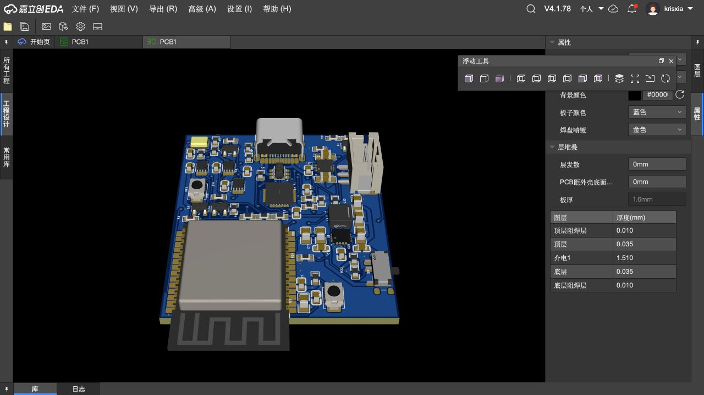
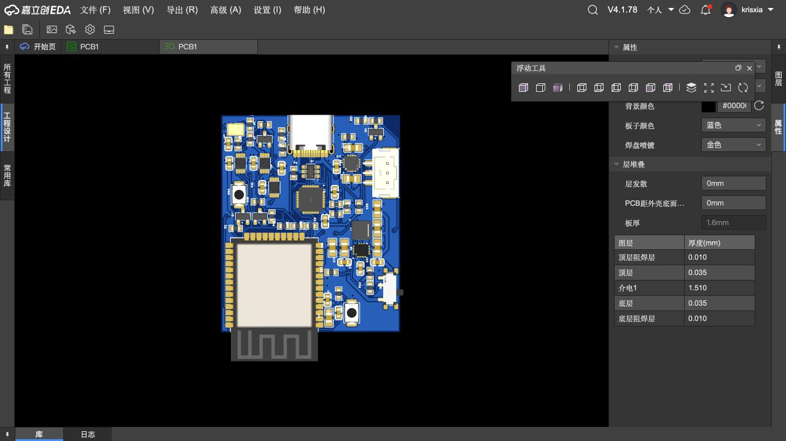
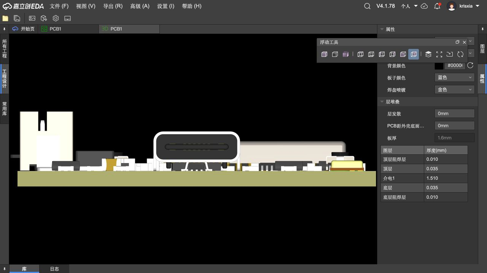
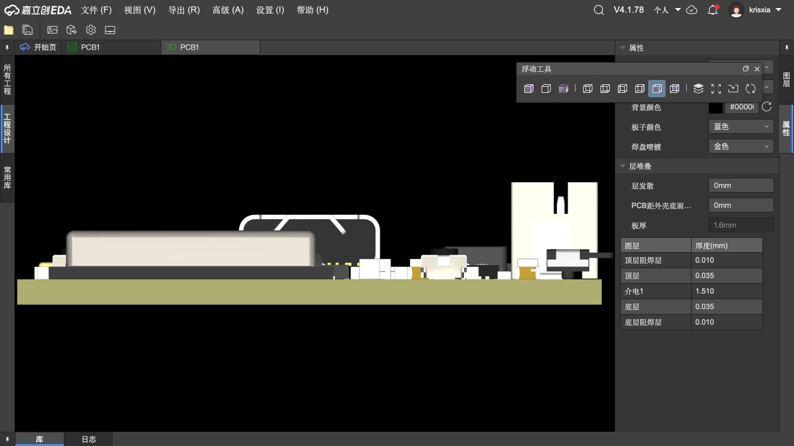
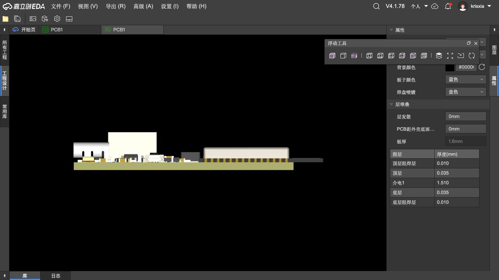
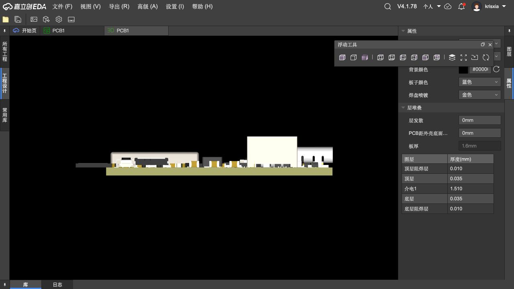
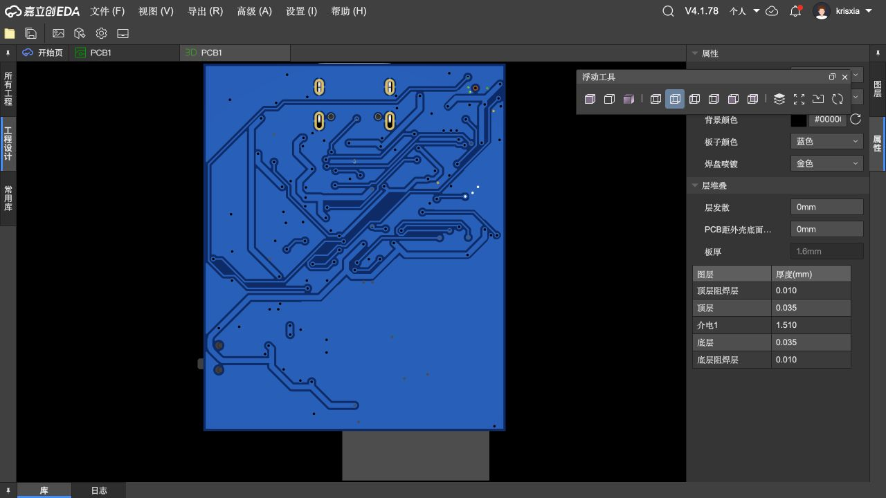

# VOXU A2 多角度预览

2026-10-24 短边居中版。以下为立创 EDA 专业版实际模型截图。板框 37 × 45 mm，厚 1.6 mm；ESP32 天线另伸出约 6 mm。渲染为蓝色阻焊/金色焊盘，仅用于几何观察；当前低成本报价选项是绿色阻焊/OSP，成品颜色和表面外观会不同。

[完整原生源工程](../../source-backups/2026-10-24-short-edge/VOXU-A2-37x45-TypeC-centered.epro2) · [装配 STEP 模型](../../source-backups/2026-10-24-short-edge/VOXU_A2_37x45_TypeC_centered.step)

## 整板透视

## 俯视：Type-C 在上方短边正中

## 从 Type-C 插口看向主板

## 从天线端看向主板

## 左侧

## 右侧

## 底面

## 检查范围

原生 DRC：141 项、0 问题。3D 模型检查只能说明模型中可见的布局与方向，不替代实际器件公差、USB 插头外壳间隙、功能测试和制造审查。该版尚未放行生产，实际 PCBA 总价仍待取得。
